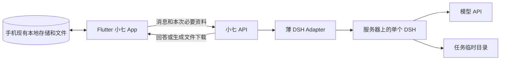
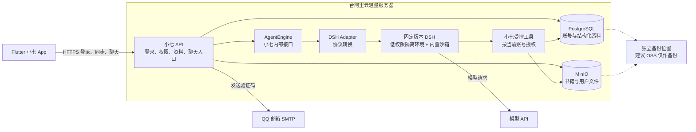

# 小七首版新架构方案：本地优先 + 单机 DSH Adapter

日期：2026-10-06  
推进顺序更新：2026-10-07（按用户确认）  
状态：目标架构决策稿；尚未按本方案迁移或部署

本轮决策：四阶段优先级基本不变，仍是对话链路 → 数据保存 → 多用户隔离 → 技能创建。仅将第二阶段由 PostgreSQL/MinIO 云端持久化改为复用并验证手机本地持久化；云端资料存储和跨设备同步暂缓。完整安全要求在对应阶段落实，不全部作为第一阶段的前置任务。

## 0. 已确认的开发顺序

**先能对话，再能保存，再分开用户，最后让用户创建技能。每阶段验收后再进入下一阶段。**

| 优先级 | 本阶段只做什么 | 通过标准 |
|---|---|---|
| 1：单实例对话 | Flutter → 小七 API → 薄 Adapter → 单个固定版本 DSH 实例；复用现有聊天界面，仅接文字对话与必要错误反馈 | 从 Flutter 发送消息，实际经过 API、Adapter 和 DSH 得到回答；能连续对话；模型失败或连接中断有明确反馈，不虚报成功。记录实际调用路径及验证结果 |
| 2：本地数据持久化 | 复用项目现有本地存储和文件机制，核验聊天、书籍、笔记、阅读进度及已下载生成文件的保存；不接 PostgreSQL/MinIO | 关闭并重开 App 后已保存内容仍可读取；断网能查看本地内容；核对文件与记录引用；保存失败不显示成功。实施前核实已有存储，不因示例提到 SQLite 或 JSON 就更换技术 |
| 3：多用户隔离 | 接入可信账号身份和归属校验，为不同用户的 DSH 执行环境配置独立 Docker 容器、工作目录、网络边界及资源配额 | 两个测试账号不能互读资料或操作对方任务；终止 A 的容器、触发 A 的内存或 CPU 配额时，B 能继续对话和取回结果；同时验证共享 API 仍可用 |
| 4：技能创建 | 用户创建、保存和使用纯文本 SKILL.md；原件保存在手机，使用时加载到对应用户执行环境 | 重开 App 后仍能读取和使用；A 的技能不被 B 加载；路径和文件大小受限制，技能内容不能修改系统权限 |

第一阶段不建设多用户路由、PostgreSQL、MinIO、用户插件或 A2UI；仅保留最小临时会话状态，不承诺重启后保留。DSH 自身必要运行组件不等于本产品的用户插件功能。

前两阶段使用开发者控制的环境和可丢弃测试数据，不开放公众注册或任意代码执行；模型密钥仍只保存在服务端，开发入口限制访问。Docker 多用户隔离及完整资源配额在第三阶段实施，不阻塞第一阶段；与对话无关的 Shell/Python 工具不启用。

第三阶段的“互不影响”指可验证的用户执行环境故障隔离，不承诺同一台宿主机断电或共享 API 故障时 B 仍可用。容器可按需启动，不要求每个注册用户永久占用一个运行实例。身份验证沿用并核实现有能力；本地保存用户资料不代表取消服务端鉴权，所需最小身份和配额记录在第三阶段确定。

第四阶段只支持文本技能，不接收附带脚本、安装依赖或可执行插件包。文本技能风险较低，但仍视为不可信指令，沿用第三阶段的权限边界。技能创建界面实施前按现有 UI 确认交互，不提前扩展成市场。

**暂缓：插件市场、A2UI、无感恢复。**插件生成、Book to Skill 自动生成流程、教学小游戏等扩展也不加入这四阶段的完成标准；待前四阶段跑稳后逐项确认和验证。

PostgreSQL、MinIO、跨设备云同步亦暂缓。下文标注“历史云端方案”的内容只供将来重新评估，不作为当前四阶段的目标或上线门槛；其余安全条款按实际启用能力分阶段验收。

> **先看结论**：Flutter 在手机保存用户资料，通过小七 API → 薄 Adapter → 单个 DSH 处理 AI 请求。DSH 仍在开发主机或服务器运行，不移植到手机。单实例就是一个正在运行的 DSH 程序副本，前两阶段供开发者验证，不等于多用户共用记忆。

本方案记录这轮讨论的目标方向，并取代旧文档中的目标部署选择：[旧开发计划](../plans/2026-10-06-harness-simplification-development-plan.md) 与 [DSH 迁移计划](deepseek-harness-migration-plan.md)仍保留现状和历史推进记录；其中 FC、Tablestore、OSS 在线存储及外部沙箱描述不再是新的目标架构。新方案尚未迁移或部署，迁移完成前旧链路仍可能在运行。

## 1. 当前目标架构

长期资料以手机副本为准。仅将当前请求所需上下文和用户选定资料发送给 AI，不默认上传整个书库。本地优先不等于完全离线或数据从不离开手机；云端 AI 仍需联网并接收所提交内容。

### 历史云端方案（暂缓，不是当前目标）

图中的 API、AgentEngine、Adapter、DSH、数据库和 MinIO 都放在同一台服务器上；DSH 执行环境必须与业务数据服务分开权限和网络边界，具体要求见第 5 节。**AgentEngine 是代码接口，不是另一台服务器或云服务。**上方 PNG 是原始组件关系示意，不作为隔离配置或安全验收证据；安全边界以本文和更新后的 Mermaid 图为准。

## 2. 历史云端方案的组件职责（暂缓）

| 组件 | 首版职责 |
|---|---|
| Flutter App | 页面、聊天输入输出、阅读和笔记交互；保留必要本地缓存与离线查看 |
| 小七 API | 邮箱验证码、登录会话、账号权限、资料同步、文件上传下载、聊天请求入口 |
| AgentEngine + DSH Adapter | 用小七自己的精简接口调用 DSH；转换消息、工具调用、进度和错误 |
| DSH | 固定版本运行 Agent 和已启用能力；调用模型及小七提供的受控工具 |
| PostgreSQL + MinIO | PostgreSQL 保存账号和结构化记录；MinIO 保存书籍等文件。两者都是服务器本机服务 |

QQ 邮箱是系统发件箱，不是所有用户共用的登录账号。用户以自己验证过的邮箱识别账号；登录注册是否继续沿用现有白名单，按首发用户范围执行。

## 3. 当前数据保存规则

| 数据 | 当前保存位置与规则 |
|---|---|
| 书籍、附件、已下载的生成文件 | 手机本地文件；下载并写入成功后才显示已保存 |
| 书架、笔记、阅读进度、聊天记录 | 复用现有本地存储；不以 DSH 内部日志作为唯一副本 |
| 用户创建的技能 | 第四阶段保存在手机，按选定版本提交给对应用户执行环境 |
| 任务运行状态、上传副本、待下载结果 | 服务端受控临时状态；第二阶段明确保留期限、领取及清理方式，不承诺重启续跑 |

实施时核实 DSH 工作目录、会话日志和工具输出的实际落盘位置，清理覆盖成功、失败、取消和过期任务；不能只删一个临时目录就声称服务端无留存。日志不记录不必要的正文或凭证，模型供应商的数据处理另行核实。

本版不承诺换手机登录即可找回资料；卸载、清除数据或设备损坏可能丢失本地内容。第二阶段核实现有导出、导入和恢复能力并记录限制，不擅自增加云备份系统。用户人数本身不决定是否需要云存储，将来按同步和恢复需求重新评估。

### 历史云端存储与备份设计（暂缓）

| 数据 | 主存储 | 说明 |
|---|---|---|
| 账号、书籍目录、笔记、阅读进度、聊天记录 | PostgreSQL | 每条记录带账号归属；聊天数据使用小七自己的结构，不把 DSH 内部会话格式当唯一副本 |
| 最小任务记录 | PostgreSQL | 保存任务编号、账号归属、请求去重标识、状态、结果引用和必要时间；用于查询、中断标记及避免重复执行，不保存可续跑的完整执行快照 |
| 书籍原文件、用户保留的附件或生成文件 | MinIO | 仅保存用户明确保留的文件；通过小七 API 检查权限后访问 |
| 页面状态和近期打开内容 | Flutter 本地缓存 | 用于快速打开和离线查看；登录同步后的云端数据是跨设备来源 |
| 正在执行的临时状态、DSH 中间上下文、临时工作目录 | 当前运行进程/临时目录 | 首版不做跨服务器重启的任务快照和恢复；临时文件完成或过期后清理 |

因此，同一账号能在另一台设备取回已同步的书籍、笔记、进度和聊天记录；如果服务器进程重启，未完成的 AI 任务不承诺原地续跑。用户已保存到账号里的文件仍应保留。

### 备份结论

PostgreSQL 和 MinIO 同在一台服务器时，主机或磁盘故障可能同时影响两者。**跨设备同步不等于故障备份。**建议用阿里云 OSS 作为异地备份目标，只备份数据库和 MinIO 数据，不承担在线读写。恢复时可从最近一次备份还原，不是自动无感切换。

异地备份是向真实用户开放云端资料保存的前置条件。实施前确定备份频率、保留时长、可接受的数据丢失时间和恢复时间，并实际演练恢复；具体数值尚未确定，不作为既有承诺。备份未就绪时仅使用可丢弃的测试数据。

数据库与文件备份需要可配对的恢复清单，恢复后核对账号、笔记、文件引用和文件校验值。备份凭证不提供给 DSH；限制备份写入账号删除历史备份的权限，恢复凭证单独保管。备份失败要告警，不能只检查备份任务是否启动。

## 4. 登录和使用流程

沿用现有本地阅读和登录体验；登录仅用于授权云端请求，不意味着资料自动同步。以下第 5 项同步流程暂缓；不重建登录系统作为第一阶段前提。

1. 未登录用户可以进入首页，使用本机已有的阅读和笔记功能。
2. 发送聊天、重试或续写等云端操作需要登录时，打开现有邮箱登录页；保留原输入，取消则回到原页面。
3. 登录成功后回到原输入，由用户再次点击发送；不自动提交。
4. API 以已验证账号绑定数据和工具调用。Flutter 不直连 PostgreSQL，也不持有 MinIO 管理密钥。
5. 首次登录后本地资料如何同步、遇到同一笔记在两端都修改时如何合并，实施前按现有同步能力核验；不得静默覆盖用户内容。

## 5. AgentEngine、技能、插件和沙箱

### Harness 可替换

Flutter 只访问小七 API，不直接调用 DSH。AgentEngine 只定义当前产品确实需要的最小调用与事件格式；首版只有 DSH Adapter 一个实现。以后新增 Harness 时再做对应 Adapter，不提前建设多引擎工厂或插件市场。

AgentEngine 对上提供小七自己的消息、进度、能力结果和错误格式；数据库中的聊天与用户资料也由小七定义。这能缩小迁移范围，但不同 Harness 的工具、会话和流式事件仍需适配，不保证零改动切换。

### 技能与插件范围

- **技能**：以说明文字和资源为主，教 Agent 如何完成阅读任务；加载技能本身不运行程序。
- **插件/工具**：首版使用小七审核过的内置能力，通过 API 或内部工具桥调用，并由后端检查账号权限。
- **不纳入**：主题、回复风格/Persona、第三方插件市场、用户任意上传并运行插件代码。
- Skill 文件不能提升权限；Agent 只能使用服务端明确开放的工具。

小七定位为 Agent 应用：根据用户目标读取资料、调用受控工具、执行步骤并保存结果；不以是否拥有插件市场作为判断条件。用户创建纯文本 SKILL.md 已纳入第四阶段；Book to Skill 自动生成、教学小游戏生成、插件生成与市场安装仍为后置方向，不是当前已支持的功能。来自 GitHub 的技能若附带脚本或依赖，按可执行代码审核，不纳入第四阶段；生成内容也不能自动获得执行权限。后续扩展需单独确认产品流程、权限和验收范围。

### DSH 沙箱

首版使用 DSH 自带沙箱作为一层保护，同时在同一服务器上配置低权限隔离执行环境；不另建通用沙箱平台。实际 DSH 组合必须明确装载沙箱执行器和策略，并在目标 Linux 服务器验证沙箱确实生效；只安装 DSH 或放进容器不等于所有工具自动受保护。

DSH 官方沙箱的主要边界是文件读写范围，网络访问和进程可见性不由这项沙箱策略统一限制。因此：

- 为每次执行使用只含当前授权资料的工作目录；不把整个书库、数据库凭证或 MinIO 管理密钥交给 Agent。
- Agent 通过小七受控工具访问账号数据；服务器按已登录账号授权，不采信模型自己传来的账号编号。
- 普通技能和已审核工具可以使用；首版不安装来源不明的可执行插件。
- 若保留 Python 执行，必须确认调用路径实际经过 DSH 沙箱，并设置运行时长、输入/输出大小等限制。若这项检查不通过，先关闭 Python 执行能力，阅读、聊天和纯指令技能仍可用。

DSH 官方目前将项目标为实验性预览版本，故首版固定已验证版本，不自动追新；升级单独测试。

### 必须落实的执行和权限边界

1. **执行权限**：DSH 及其子进程使用独立非管理员身份；不使用特权容器，不挂载宿主机管理套接字、业务数据目录或服务配置。沙箱策略和插件配置不可由模型执行的代码修改；每次任务仅提供当前授权资料，并清理临时目录。
2. **网络权限**：默认拒绝不必要的出站访问，按需允许模型服务和受控工具入口；阻止任意访问数据库、MinIO 管理端、云实例元数据和其他内部服务。允许入口仍需鉴权，不能因为来自本机就信任。模型凭证只对必要的请求组件可用，不能让执行脚本继承包含全部服务密钥的环境。
3. **账号权限**：每次读写记录、下载文件、查询或停止任务、调用工具，都由后端使用可信会话绑定账号；不采信模型或客户端自行提交的账号归属。文件编号和路径不是授权依据，检查路径越界和跨账号访问；任务工具凭证仅能操作绑定的任务和授权资料。
4. **不可信内容**：书籍、附件、技能说明和工具返回文本均不能更改系统权限。即使模型遵从其中的恶意指令，后端也必须阻止越权读写和未经授权的数据外发；不把“提示模型不要这样做”当作安全控制。
5. **执行开关**：Python 在隔离、资源限制和停止能力验证前默认关闭；具备快速停用代码执行与单个工具的开关。若关闭会影响现有已承诺能力，应先记录和告知，再决定首版范围，不能隐藏降级。

## 6. 部署、可靠性和费用范围

当前仅部署 API、Adapter 和 DSH，用户长期资料留在手机；主要费用为服务器和模型请求。下方涉及 PostgreSQL、MinIO、云端资料恢复与同步的部署项属于历史后置方案，不在本轮建设。2 核 4G 仅为测试起点，容量需实测。

- 一台轻量服务器上运行 API、DSH、PostgreSQL、MinIO；建议先以 2 核 4G 做小规模试运行，不把优惠价或“稳定运行”当作容量证据。
- 公网只开放小七 HTTPS API；数据库、MinIO 管理端和 DSH 控制端口仅限服务器内部访问。
- 模型密钥、SMTP 授权码、数据库密码保存在服务器受控配置中，不下发到 App、不进入模型提示和普通日志。
- 服务器是单点故障；首版接受短时不可用，账号资料靠异地备份恢复。暂不建设多机高可用、自动扩容或独立任务快照服务。
- 主要费用是轻量服务器、模型调用和异地备份存储。QQ SMTP 使用现有邮箱；MinIO 是本机软件，不是另购的 OSS 服务。

### 首版运行底线

| 项目 | 必须落实的行为 |
|---|---|
| 资源和费用 | 配置账号及全局并发、排队上限、任务时长、进程内存/CPU、临时磁盘、文件及解压后大小、输出量、模型调用与费用预算；超过上限明确拒绝或终止，避免单任务拖垮数据库。阈值在目标机器测量后记录，不能无限制运行 |
| 登录保护 | 验证码短期有效、一次使用，按账号和来源限制发送及尝试次数；登录会话可过期和撤销；日志不记录验证码、完整令牌和服务密钥 |
| 运维 | 记录固定版本与依赖锁定信息；监控磁盘、内存、任务失败、模型用量及备份失败。保留任务编号和错误原因用于排查，避免记录不必要的书籍正文和私人内容；安全更新先验证再部署 |
| 重启与停止 | 手机断线不等于停止任务；服务重启后把遗留未完成任务标为中断或待核对，不假装续跑。停止需要结束子进程并清理资源，确认前不显示已经停止 |
| 重试与同步 | 同一提交使用去重标识；结果未知时先查询，不能自动重复执行有副作用的操作。笔记同步冲突保留双方内容，具体合并交互实施前确认；切换账号时隔离缓存，不能显示上个账号的私人资料 |

最小任务记录与业务结果应保持一致；文件落盘失败不能显示交付成功。对于无法确认是否已经完成的写入，记录待核对状态，不盲目重试。首版仍不建设跨重启的执行快照和自动续跑系统。

## 7. 历史云端迁移计划（已由 2026-10-08 决策替代）

本节以下内容保留为历史草案。用户已确认旧云端数据是可丢弃的开发测试数据，现阶段不需要备份或迁移；实际部署状态和清理清单见 [2026-10-08 第一阶段状态与旧资源清理](2026-10-08-stage1-deployment-and-legacy-cleanup.md)。

当前先盘点并复用本地存储，只验证新对话链路，不执行下方云存储迁移。本次未授权删除 FC、Tablestore、OSS 或已有云端资料；如存在云端独有数据及认证依赖，另行盘点、备份并确定保留或导出方式后再切换。

| 当前/旧方案 | 新目标 | 迁移要求 |
|---|---|---|
| FC API 与 DSH Worker | 同一 VPS 上的小七 API 与 DSH 运行进程 | 先验证长请求、断连、进程重启和资源占用；运行中任务不做快照恢复 |
| Tablestore | PostgreSQL | 先定义账号数据映射并做只读核对、备份和迁移演练 |
| OSS 在线文件 | MinIO 在线文件 | 搬迁书籍和用户保留文件，按文件清单与校验值核对后才切换读取 |
| 外部代码沙箱 / 现有 Python 通道 | 优先评估 DSH 内置沙箱 | 不能把文件限制等同网络/进程隔离；不满足边界时暂留受控外部执行环境或关闭 Python，不静默降级 |

开发先按第 0 节的四阶段推进，使用测试数据，不提前搬迁或删除旧系统资料。以下是阶段验证后的正式迁移顺序，不替代开发顺序：

1. 盘点现有用户资料、对象文件、邮件认证和 DSH 版本，做可恢复备份。
2. 在测试服务器部署 API、PostgreSQL、MinIO 和锁定版本 DSH，验证邮箱登录、同账号数据同步及文件读写。
3. 接入 AgentEngine/DSH Adapter、现有受控技能和工具；验证沙箱及账号隔离。
4. 用少量账号迁移副本，检查书籍、笔记、进度、聊天和已保存文件；演练备份恢复。
5. 验收通过后切换新请求；确认旧路径无在途任务且数据核对完成，再退役 FC、Tablestore、旧在线 OSS 路径和被替代代码。

切换前记录旧版本、备份点、切换窗口和回退步骤。切换期间避免新旧服务同时写入产生分叉；切换后已有新数据时，回退必须先核对并保全新增记录和文件，不能直接恢复旧备份覆盖。确认恢复及回退方案可执行后再删除旧资源。

## 8. 首版验收标准

当前验收以第 0 节和第 3 节为准；下方跨设备同步、云端数据库/文件恢复及同步冲突条款暂缓。验证 App 重启后本地内容仍在、保存失败如实反馈、多用户任务隔离和技能不串用；不得以本地持久化通过声称云同步或备份恢复通过。

- 同一邮箱账号在两台设备登录后能读取已同步的书籍、笔记、阅读进度和聊天记录。
- 未登录可使用本地阅读/笔记；登录取消会保留输入，登录后不会未经确认自动发送。
- AI 任务调用 DSH Adapter；用户聊天记录由小七持久化；服务器重启后不谎报未完成任务已恢复。
- 越权账号无法读取其他账号记录或文件；App、Agent 提示和日志均不含服务端密钥。
- 沙箱在目标 Linux 服务器实际生效；Python 执行受限且可停用；未知来源的可执行插件不能进入运行环境。
- 至少完成一次从异地备份恢复数据库和文件的演练，核对文件与记录关联；未通过前不向真实用户开放云端资料保存。

### 安全与异常验收证据

| 检查 | 通过标准 |
|---|---|
| 执行隔离 | 在目标 Linux 配置下尝试越界读写、访问内部服务和实例元数据、读取凭证及修改安全配置，均被拒绝；覆盖所有已开放执行工具，不只检查一个沙箱示例 |
| 账号隔离 | 使用两个测试账号替换记录、文件及任务编号，读、改、下载、停止均无法越权；账号切换不暴露前一账号缓存 |
| 资源与停止 | 超时、超大文件、资源超限及停止任务有明确结果；执行子进程不残留，其他用户的基础请求仍可处理；记录实际容量与限制值 |
| 故障与恢复 | 验证断网重连、重复提交、服务重启、文件保存失败及同步冲突；不重复写入、不虚报完成、不静默覆盖；备份恢复和切换回退有记录 |
| 登录与内容攻击 | 验证码重放、过期与反复尝试被限制；含恶意指令的书籍或技能不能提升工具权限或外发未授权资料；普通日志中无凭证 |

验收分别记录“代码完成”“自动化/静态检查”“目标服务器隔离与负载验证”“同状态视觉验收（涉及 UI 时）”“真机验证”“已部署”和“上线后有效性”，未执行的项明确标为待验收。不能用文档描述或一次正常聊天代替这些证据。

## 9. 实施前待定项（不扩展首版功能）

各项在所属阶段实施前确定；第一阶段只需核实已有 Flutter 入口、API 调用路径、DSH 固定版本和最小对话协议，不因后续事项未定而停工。第二阶段确认现有本地存储、导出恢复能力、临时资料清理和结果领取；以下异地备份、同步及云数据迁移事项均暂缓。

1. **异地备份**：确定目的地、频率、保留策略、数据丢失与恢复时间目标及凭证权限；上线前演练恢复。
2. **执行环境**：确定锁定的 DSH 版本、隔离配置、网络允许范围和工具清单；Python 未验证前关闭，不承诺仅靠文件沙箱提供完整隔离。
3. **运行阈值**：在目标机器确定并发、时长、内存、磁盘、文件与模型费用上限，记录告警和停用方式。
4. **数据行为**：核验现有首次同步、冲突处理、重复提交和停止交互；涉及用户体验变化时先确认，不能默默改变行为。
5. **迁移安排**：明确少量获准账号试运行范围、数据核对清单、切换和回退步骤；通过首版验收后再扩大使用。

## 参考资料（官方一手资料）

- [DSH 安全说明](https://github.com/deepseek-ai/deepseek-harness/blob/master/SAFETY.md)：实验状态、最小权限和不将沙箱当唯一防护。
- [DSH 沙箱子系统](https://github.com/deepseek-ai/deepseek-harness/blob/master/docs/subsystems/sandbox.md)：文件策略范围，以及网络和进程边界。
- [OWASP 提示注入防护指引](https://cheatsheetseries.owasp.org/cheatsheets/LLM_Prompt_Injection_Prevention_Cheat_Sheet.html)：授权与最小权限控制放在模型之外，不依赖提示文本阻止越权；本次安全补充参考。
- [DSH Skills 子系统](https://github.com/deepseek-ai/deepseek-harness/blob/master/docs/subsystems/skills.md)：技能是按需加载的指令，技能来源与注册方式。
- [MinIO S3 兼容说明](https://min.io/product/s3-compatibility)：MinIO 兼容 S3 API；这不等同于自动获得托管 OSS 的可用性和备份能力。

以上链接于 2026-10-06 查阅。参考实现之前，应再次核对所锁定 DSH 版本对应的文档与实际配置。

## 当前状态

本文件只确定目标架构和迁移门槛；没有修改业务代码、迁移数据、部署服务器或执行真机/负载验收。此前的开发计划与现有实现记录保留，后续实施应以本方案为目标架构，并分别记录代码、自动化、真机、部署和恢复验收结果。
