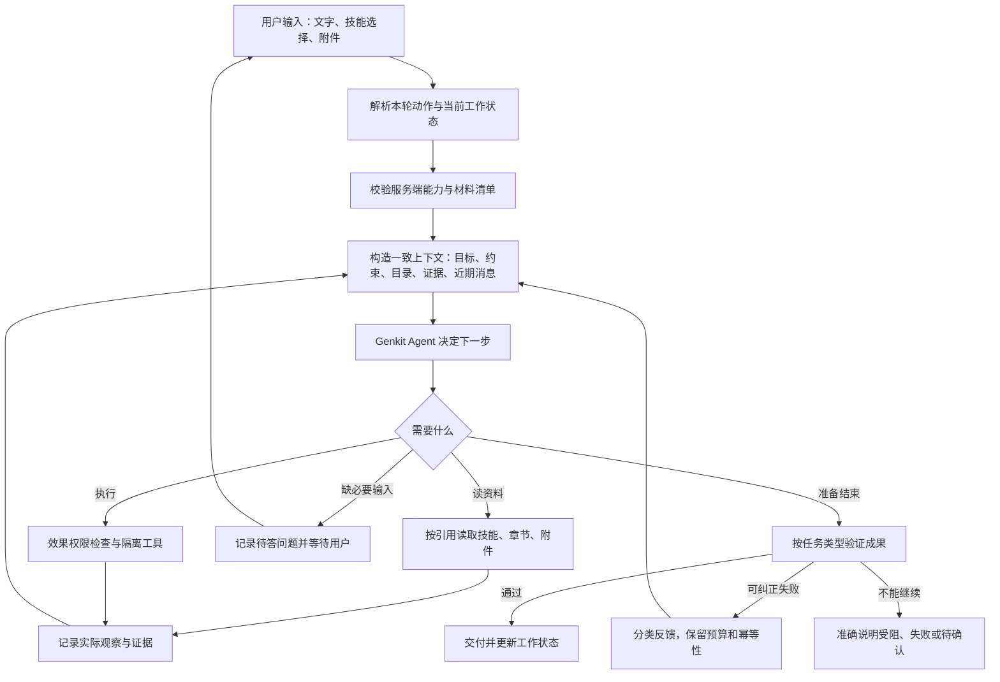

# 小七 Agent 架构诊断：技能、任务与上下文为何没有形成闭环

日期：2026-11-04。审计源码：`475663fb16c39a973b92fb79a97f8301a6b3c311`。性质：只读架构审计与方案建议，未修改运行代码、未升级依赖、未部署。

使用方式：本文件保留问题证据与复用研究；实施以 [统一能力契约与工作生命周期规格](C:/Users/20833/Desktop/xiaoqi_app/docs/plans/2026-11-04-unified-capability-contract.md) 为主线。2026-11-04 用户后续确认：标签发出后从输入框移除，不加能力常驻展示；停止只暂停工作，不加结束工作按钮；运行中补充在安全边界处理；完成后修改建立关联工作；当前工作绑定合法旧版，新工作使用新版；同一问题含首次最多尝试五次，仍失败则停止并简短说明、等待指示。正常成功的其他调用不占该问题额度。

## 先看结论

**主要缺陷在小七自己的 Harness 连接层：界面选择、运行时可用能力、跨轮任务状态和完成条件，尚未使用一致的语义。现有证据不支持“Genkit 选错了”或“整个 Agent 必须重写”。**

现有系统已经有 Agent 循环、服务端会话、快照、技能中间件、工具、隔离执行、授权中断、恢复和交付检查。问题是一些环节接错了，一些检查只验证了局部成立。

先修三件事：

1. **修正技能选择的入口与继承。**标签回填确实会影响下次请求；“技能标签＋附件＋空文字”现在会优先走技能介绍分支。
2. **让同一项工作的目标、材料和等待事项跨轮保留。**聊天历史存在，不代表每个决策环节都拿到了足够的任务信息。
3. **区分了解技能与执行技能。**读取说明不应自动变成“必须规划并交付文件”的任务；实际执行则必须检查可验证成果。

然后补齐资源可读性、上下文预算、错误分类与真实模型回归。优先复用 Genkit 已有组件，不增加第二套主 Agent 框架。

## 证据范围与判断边界

| 来源 | 本次实际做了什么 | 能说明什么 |
|---|---|---|
| 两张截图 | 直接查看 | 可见“已选择”与下一轮“技能不在列表”的矛盾；技能与 PDF 同发时返回介绍 |
| 第一段录屏，约 27 秒 | 定时抽帧查看 | 询问技能用法后出现读取与交付检查反馈，界面显示已停止；不能据此判断停止由用户还是运行层触发 |
| 第二段录屏，约 12 秒 | 定时抽帧查看 | 已解释用法，上传 PDF 后又泛化询问用途；再发技能标签又返回固定介绍 |
| 当前代码 | 追踪客户端发送、服务端路由、技能加载、会话、工具与验证 | 确认下文的代码分支与设计缺口 |
| 本地现有测试 | 45 项定向测试通过 | 这些局部契约在测试条件下成立，不代表录屏路径已通过 |
| 静态检查 | 7 个相关服务端文件 `dart analyze` 通过 | 无分析器问题，不证明任务语义正确 |
| GitHub 与官方文档 | 实际联网核对组件、版本与许可证 | 支持复用选择；没有安装或接入新组件 |

没有读取录屏对应账号的生产会话快照、模型实际输入和安装记录，也没有核对录屏时的 APK/服务端版本。因此，**“那一轮为何只列出两个技能”的唯一根因尚未确认**：可能涉及当时账号安装/版本、发送选择、目录生成或模型行为，不能只凭截图任选一个解释。本报告指出的是当前源码中可确认的机制，以及与录屏吻合的高可信断点。

本次没有操作手机、没有重跑付费模型完整链路，也没有验证音轨。真机验证：**未执行验证，待用户真机验证**。

录屏抽帧留在 [第一段](C:/Users/20833/Desktop/xiaoqi_app/.codex-artifacts/agent-audit-20261104/video1-contact.jpg) 与 [第二段](C:/Users/20833/Desktop/xiaoqi_app/.codex-artifacts/agent-audit-20261104/video2-contact.jpg)。

## 一、按书中的方法看，哪些环节有问题

书籍为李博杰《深入理解 AI Agent：设计原理与工程实践》。书中的基础表达是“LLM＋上下文＋工具”；§1.2.2 进一步把 Harness 分为上下文、工具、约束、验证、纠正。这里按用户提出的六环逐项检查，而不是将扩展后的六环公式冒称为原书原句。

| 环节 | 当前已有 | 本次判断 | 必须补齐 |
|---|---|---|---|
| LLM | DeepSeek/MiMo 适配、结构化意图输出、工具调用预算 | 没有证据证明换模型能解决确定性的入口错误；不同模型的实际可靠性仍需测量 | 在相同任务前缀和工具环境下评测模型，记录成本、延迟、成功与失败 |
| 上下文 | 服务端快照、历史消息、附件目录、可见历史产物、技能正文加载 | **最核心的连接缺口之一**：路由看到的上下文比执行器少，缺乏明确的跨轮目标/等待状态；没有完整压缩预算层 | 结构化任务状态＋一致的上下文构造＋分层压缩/取回 |
| 工具 | Genkit skills/MCP、材料读取、任务文件、Python/Shell、技能脚本 | 不是工具数量不足；主要是资源寻址、宿主能力与技能假设不一致 | 包内资源清单、稳定产物引用、可执行能力预检、清晰错误 |
| 约束 | 租户隔离、版本绑定、效果权限、沙箱、确认、取消和预算 | 基础值得保留；**选择、读取、执行义务容易被混同** | 将选择偏好、知识激活、执行授权和完成要求分别表达；运行时硬性执行同一问题五次上限 |
| 验证 | 工具成功计数、产物类型/数量、大小与哈希核对 | 有检查，但“看用法”被过度检查；“真正完成任务”又可能检查不足 | 按任务类型验收，检查成果内容、来源与覆盖，不只数工具/文件 |
| 纠正 | 意图重试、技能工具恢复、两次交付补救、Stop hooks、恢复日志 | 已有恢复机制；部分错误归因过粗，补救容易围绕错误完成条件重复 | 分类错误、定位首个断点；同一问题含首次最多五次，允许诊断与联网搜索，第五次仍失败则停止等待，不无限换入口重试 |

原书对应原则：§1.2.2 信息充分性、输入隔离和纠正闭环；§1.2.3 简单、透明和清楚的工具接口；§2.5.3 少量目录常驻、正文按需加载；§2.7.4 分层压缩；§4.2 按能力选择工具或 Skill＋通用执行器；§6.5.2–6.5.3 首错归因与轨迹前缀回归。

## 二、具体发现与修复优先级

### F1 · P1：自动回填的技能标签再次参与请求，并能让附件落入介绍分支

**已确认的代码行为：**

- 发送后，`setMessage('', selectedCapability, isExplicit: false)` 将技能/插件/MCP 标签写回输入框。[发送后回填](C:/Users/20833/Desktop/xiaoqi_app/lib/pages/home_page.dart:2758)
- 再次发送时，只要存在这类标签，就将 `capability_scope_operation` 设为 `replace`；此判断不区分手动选择与自动继承。`capabilityTagOrigin` 虽记录了来源，但不参与该分支。[下一次发送](C:/Users/20833/Desktop/xiaoqi_app/lib/pages/home_page.dart:2623)
- 如果用户没有填写文字，客户端先判断是否有能力标签，再判断是否有附件。因此“自动回填标签＋新 PDF＋空文字”会被标成 `capability_only`。[入口分类](C:/Users/20833/Desktop/xiaoqi_app/lib/pages/home_page.dart:3518)
- 服务端遇到空文字及 `capability_only`，直接返回固定介绍，没有检查“本次还有材料，或者正在等待用户上传材料”。[提前返回](C:/Users/20833/Desktop/xiaoqi_app/xiaoqi_harness/genkit_server/lib/src/agent_runtime.dart:1708)

这解释了为什么不能只把标签藏起来：标签背后的元数据正在改变请求。删除标签也不只是视觉删除——下一次发送可产生 `clear`，服务端进一步将原选择加入排除集合。[清除语义](C:/Users/20833/Desktop/xiaoqi_app/xiaoqi_harness/genkit_server/lib/src/capability_scope.dart:30)

**建议：**发送草稿、会话选择偏好、当前任务绑定三者独立存储。自动继承不能伪装成一次新的显式选择；附件补交必须结合待完成任务判断。即使产品决定让技能持续生效，也应由会话状态表达，不靠反复向空输入框插入待发送标签实现。

用户后续已确认：标签随消息发送后从输入框移除，不回填，不另加“当前工作使用的能力”展示。选择记录交由工作状态保留；发送失败仍须保留或恢复未成功提交的草稿意图。

### F2 · P1：“你已选择”在技能可用性校验之前产生

固定介绍从请求里的名称、描述拼接出来，并在 `SelectedSkills` 构造之前返回。[介绍函数](C:/Users/20833/Desktop/xiaoqi_app/xiaoqi_harness/genkit_server/lib/src/agent_runtime.dart:98)、[真实技能解析入口](C:/Users/20833/Desktop/xiaoqi_app/xiaoqi_harness/genkit_server/lib/src/agent_runtime.dart:1751)

这意味着第一轮介绍不能证明账号内存在对应安装、版本文件能读到、脚本能运行。现有单元测试甚至用空临时 store 和没有 `version_id` 的选择完成这条介绍路径，并只断言介绍文字。[现有测试](C:/Users/20833/Desktop/xiaoqi_app/xiaoqi_harness/genkit_server/test/agent_runtime_test.dart:227)

**建议：**介绍也从服务端校验后的能力描述生成，分别记录“已选”“可读取”“可执行”“因何受限”。这是轻量解析与确定性校验，不要求仅点选技能就执行脚本或调用付费模型。

第一张截图中的后续“列表没有 book-to-skill”还需该账号当时的 `capability_id/version_id/catalog` 与模型输入才能最终归因。应保留精确 ID 和失败码，不能靠显示名推断安装状态。

### F3 · P1：有历史记录，但任务识别缺少关键的跨轮语义

**已有能力不能抹掉：**客户端沿可见聊天历史收集附件，服务端使用 `CloudSessionStore` 保存会话，还按祖先任务收集可见产物。[历史附件](C:/Users/20833/Desktop/xiaoqi_app/lib/pages/home_page.dart:3383)、[会话持久化](C:/Users/20833/Desktop/xiaoqi_app/xiaoqi_harness/genkit_server/lib/src/api.dart:344)、[历史产物](C:/Users/20833/Desktop/xiaoqi_app/xiaoqi_harness/genkit_server/lib/src/api.dart:959)

**缺口在决策输入：**意图分类器收到的最近上下文只取最多六条 user 消息的文本，不含上一轮 assistant 提出的待办/问题，也不含结构化的“等待哪份文件、目标是什么、下一步是什么”。[路由上下文](C:/Users/20833/Desktop/xiaoqi_app/xiaoqi_harness/genkit_server/lib/src/agent_runtime.dart:1073)、[实际路由载荷](C:/Users/20833/Desktop/xiaoqi_app/xiaoqi_harness/genkit_server/lib/src/intent_router.dart:93)

普通新消息会创建新执行任务 ID，而 `TurnContract` 表达的是单轮模式、技能 ID、图片数量等；当前 session custom 初始化主要保存过程展示状态。缺少一份在这些轮次之间稳定传递、经用户输入和真实执行证据更新的工作目标。[新执行任务](C:/Users/20833/Desktop/xiaoqi_app/lib/pages/home_page.dart:3462)、[单轮契约](C:/Users/20833/Desktop/xiaoqi_app/xiaoqi_harness/genkit_server/lib/src/turn_contract.dart:5)、[session custom](C:/Users/20833/Desktop/xiaoqi_app/xiaoqi_harness/genkit_server/lib/src/api.dart:1043)

所以“模型完全没有历史”不准确；更准确的是：**决定是否继续工作的环节，拿到的历史不够完整，也缺少可依赖的任务状态。**

**建议：**在已有 workflow/session 下增加明确的工作状态：目标、任务模式、材料引用、已确认约束、待用户回答的问题、下一步、完成标准、已完成证据。新轮次可以是补材料、回答问题、修改目标或新建工作；执行 ID 仍可按轮隔离，副作用权限不能因为目标继承而自动继承。

仅询问“技能怎么用”不等于已授权把整本书转换并发布。上传文件后若仍缺目标，应结合已有技能与对话，只询问真正缺少的参数，例如“做架构分析还是生成技能包”，而不是重新列一组无关用途。

### F4 · P1：了解技能与执行技能共用了强制交付条件

意图路由明确写着 `answer=问答/能力介绍`，问答/查看结果的 `skill_ids` 为空。[路由定义](C:/Users/20833/Desktop/xiaoqi_app/xiaoqi_harness/genkit_server/lib/src/intent_router.dart:70)

但显式技能只要完成条件没有被撤回，就会预加载正文并加入 `loadedSkills`；结束检查又把 `loadedSkills.isNotEmpty` 当成必须声明交付计划的条件，未以 `executesWorkflow` 统一约束。[预加载](C:/Users/20833/Desktop/xiaoqi_app/xiaoqi_harness/genkit_server/lib/src/agent_runtime.dart:2548)、[交付门槛](C:/Users/20833/Desktop/xiaoqi_app/xiaoqi_harness/genkit_server/lib/src/agent_runtime.dart:6937)

结果是“读过说明”本身就可能触发“尚未声明任务步骤与交付要求”，再向模型注入补计划的纠正消息。[交付判断](C:/Users/20833/Desktop/xiaoqi_app/xiaoqi_harness/genkit_server/lib/src/task_delivery.dart:51)、[纠正循环](C:/Users/20833/Desktop/xiaoqi_app/xiaoqi_harness/genkit_server/lib/src/agent_runtime.dart:6982)

这与第一段录屏中“解释用法时被要求补交付计划”的迹象吻合。但录屏不能证明用户没有主动停止，因此不能把“已停止”全部归因于该门槛。

**建议：**区分 `selected`、`loaded_for_reference`、`activated_for_execution`。按真实任务选择验证器：解释用法检查说明依据；文档分析检查来源/覆盖；转换技能包检查目录、引用、文件与扫描；外部操作检查权限和操作收据。不要删除验证层，而是修正它验证的对象。

### F5 · P1：通用资源读取契约与可复用技能的文件组织不匹配

`read_skill_resource` 只允许根 Markdown 或 `references/`、`assets/`、`handbook/` 下的路径；`safeSkillResourcePath` 明确拒绝其他一级目录。[工具入口](C:/Users/20833/Desktop/xiaoqi_app/xiaoqi_harness/genkit_server/lib/src/agent_runtime.dart:5534)、[路径规则](C:/Users/20833/Desktop/xiaoqi_app/xiaoqi_harness/genkit_server/lib/src/agent_runtime.dart:7393)

用户提供的 `book-to-skill` 生成规范使用 `chapters/chNN-*.md`。因此，**按该规范生成并导入的技能，即使正文写有章节链接，该读取工具也无法打开这些链接。**这不是第一张截图的已证实根因，却是明确的后续闭环缺口。

此外，单个技能资源超过 64 KiB 就报错，没有分段续读；脚本运行环境每次重建，官方 book-to-skill 适配文档已花费多条规则教模型重新发现上次输出路径。[64 KiB 限制](C:/Users/20833/Desktop/xiaoqi_app/xiaoqi_harness/genkit_server/lib/src/agent_runtime.dart:5551)、[宿主适配规则](C:/Users/20833/Desktop/xiaoqi_app/xiaoqi_harness/genkit_server/official_catalog/book-to-skill/SKILL.md:10)

**建议：**按已经验证、绑定版本的包清单开放可读文本资源，而不是靠固定目录名称证明安全；保留租户边界、路径规范化、遍历拒绝、文件类型与体积限制。资源读取增加游标/分段；跨调用文件使用稳定 `artifact_id` 及当前调用的路径映射。容器可以继续临时化，不必为了让模型记住路径而长期开着容器。

当前已完成技能脚本共享任务依赖的改动，见 [11 月 4 日实施记录](C:/Users/20833/Desktop/xiaoqi_app/docs/plans/2026-11-04-skill-script-dependencies.md:1)。这里不是重新提出“所有依赖安装都没做”，而是补资源与执行契约的一致性。

### F6 · P2：已有历史过滤和次数预算，但没有完整的上下文管理层

当前历史处理把之前轮次的 `use_skill/read_skill_resource` 返回正文替换为提示；触发条件是历史轮次，而不是逻辑工作是否仍在继续。[过滤逻辑](C:/Users/20833/Desktop/xiaoqi_app/xiaoqi_harness/genkit_server/lib/src/history_context.dart:4)、[历史引用集合](C:/Users/20833/Desktop/xiaoqi_app/xiaoqi_harness/genkit_server/lib/src/agent_runtime.dart:6117)

这种处理能减少旧技能指令干扰，但如果没有同步保存持续任务状态和可取回的资料索引，就会反复加载、重新推断。不能简单取消过滤，让过期指令无限影响后续消息。

`ModelLimits` 保存模型窗口并声明由供应商执行总窗口限制；`TaskModelClient` 统计实际 POST 尝试次数。此次检查的主要模型调用链中，未发现按总输入预算、输出预留、工具返回预算、结构化摘要和恢复指针组成的完整上下文编译层。[模型窗口](C:/Users/20833/Desktop/xiaoqi_app/xiaoqi_harness/genkit_server/lib/src/model_limits.dart:1)、[请求次数预算](C:/Users/20833/Desktop/xiaoqi_app/xiaoqi_harness/genkit_server/lib/src/task_model_client.dart:58)

**建议顺序：**先限制工具返回并落盘引用，再保存目标/约束/待办，最后做按需压缩。压缩保留工具调用与返回的配对、授权与撤销事件、材料来源、未完成条件及可取回索引；原始轨迹留存，摘要只作为派生视图。不能把“扩大上下文窗口”或“接一个向量库”当作这条链的替代方案。

这是长任务可靠性缺口；现有录屏很短，不能把截图问题归因为上下文窗口已经溢出。

### F7 · P1/P2：成果验证仍以模型声明的清单为主，缺少通用的内容验收

`TaskDelivery` 检查模型计划里的技能是否加载、指定工具成功次数、产物 MIME 和数量；运行时还核对真实产物的大小与 SHA256。这是有价值的真实性基础。[现有验证器](C:/Users/20833/Desktop/xiaoqi_app/xiaoqi_harness/genkit_server/lib/src/task_delivery.dart:51)、[产物完整性](C:/Users/20833/Desktop/xiaoqi_app/xiaoqi_harness/genkit_server/lib/src/agent_runtime.dart:6917)

但 `steps` 没有逐项验收，第一次计划由模型填写 `tools/artifacts`，工具计数也没有在这一层绑定“具体哪份输入得出了哪个验收结果”。对一般任务而言，一个 ZIP 存在且哈希正确，不代表章节完整、链接能读、来源正确、符合用户目标。官方 book-to-skill 已要求调用安全扫描脚本，但该通用交付门本身并不独立验证这些语义。

**建议：**完成标准从用户确认的任务类型产生，由运行时验证。对技能包至少检查 ZIP 可解包、必需文件、内部链接、来源元数据、章节覆盖、扫描记录与被扫描包的一致性。内容质量可补独立评审，但先用确定性规则；不必每句话都启动第二个 Agent。

允许模型提出计划，不能让它自行决定“做到多低的标准就算完成”。同时避免把只适用于完整转换的 ZIP 要求套到 analyze-only 或用法问答上。

### F8 · P2：部分恢复逻辑抹平了真正的失败原因

`SkillToolRecoveryMiddleware` 捕获除取消外的全部异常，统一报告“技能标识未匹配到本轮可用目录”，并建议按 ID 重试。其 `try` 同时覆盖 `beforeLoad`、实际技能加载、`onLoaded` 和兼容说明，不仅可能发生名称错误。[错误合并位置](C:/Users/20833/Desktop/xiaoqi_app/xiaoqi_harness/genkit_server/lib/src/skill_tool_recovery_middleware.dart:39)

这会使文件读取/版本/钩子等问题被当成同一种错误处理。复用现有交付补救、调用次数限制、取消和恢复基础；补齐错误类型与下一步动作的对应关系。不同层的重试须纳入用户确认的同一问题五次上限，不将两次补救与 SDK 重试再乘上五次。

**建议：**区分未安装、版本不可用、资源缺失、内容解析失败、权限撤销、参数错误、依赖缺失、暂时网络故障、执行结果未知。只对适合重试的错误重试；结果未知先查原执行，不重放副作用；显式要求的技能不可用时准确报告，不能静默改成另一个技能再声称完成。

### F9 · P1：停止请求、任务状态与框架终态需要统一解释

此项为用户确认“停止只暂停当前工作”后的追加只读检查，非原录屏唯一根因结论。客户端已同时中断本地流并显式请求服务端取消，服务端也已有执行取消控制器和恢复快照，不能说项目完全缺少停止链路。[客户端停止](C:/Users/20833/Desktop/xiaoqi_app/lib/pages/home_page.dart:5642)、[服务端执行控制器](C:/Users/20833/Desktop/xiaoqi_app/xiaoqi_harness/genkit_server/lib/src/api.dart:1005)。

当前取消入口可以持久化 pausing，同时立即广播 cancelled，存在停止处理中与对外事件不一致。另一个需动态核验的风险是应用执行取消与 SDK 外层取消 token 分离，Genkit 1.0.0 会把外层 token 未取消的 aborted 归为 failed；不能把该框架终态直接当用户工作已失败、完成或不可恢复。[任务状态与事件](C:/Users/20833/Desktop/xiaoqi_app/xiaoqi_harness/genkit_server/lib/src/api.dart:2707)、[SDK 分类](C:/Users/20833/AppData/Local/Pub/Cache/hosted/pub.dev/genkit-1.0.0/lib/src/ai/agents/agent.dart:581)。

**建议：**保留现有显式取消与原 task/snapshot 恢复，统一请求接受、停止收尾、暂停和待核对状态，记录停止原因；不只换按钮文案。用户暂停后等待用户继续，五次失败受阻后也不由 hook 或后台唤醒自动续跑。工具 interrupt 的回答与普通停止后的继续分别处理。具体官方机制与接入边界见主规格第 6.6 节。

## 三、建议保留的架构与补齐后的链路

现有主要路径是 `remoteAgent → defineCustomAgent + CloudSessionStore → runAgentTurn → defineAgent + skills middleware → 工具/中断 → 交付检查 → 最终回答`。这是在使用 Genkit Agent，并非完全手写一个裸 `generate` 循环。[公开入口](C:/Users/20833/Desktop/xiaoqi_app/xiaoqi_harness/genkit_server/lib/src/api.dart:344)、[执行 Agent](C:/Users/20833/Desktop/xiaoqi_app/xiaoqi_harness/genkit_server/lib/src/agent_runtime.dart:6879)

建议保留模型适配、Genkit 会话/中断协议、当前存储、隔离沙箱、版本绑定、MCP 恢复日志、权限检查和产物校验。在已有单一产品版本上整理职责，不维护第二套长期并行运行时。

需要统一的状态语义：

| 状态 | 含义 | 不应被误当成 |
|---|---|---|
| 草稿选择 | 用户准备随下一条消息提交的选择 | 已运行、已授权 |
| 会话偏好 | 本聊天希望优先使用的能力 | 每轮强制执行要求 |
| 可用能力 | 账号、版本、文件与宿主检查通过 | 已加载说明 |
| 已加载知识 | 说明/参考内容已进入本轮上下文 | 已执行工作流 |
| 执行绑定 | 本工作确实需要该能力，版本已固定 | 无条件副作用授权 |
| 已验证完成 | 对照任务标准取得可核验结果 | 模型说了“完成”、工具返回过成功 |

运行文件已达约 7,700 行，但单纯拆文件不是修复。可以在明确这些契约后，把能力解析、上下文构造、执行策略、成果验证与展示投影分别抽出；不在一次重构中同时改掉所有行为。

## 四、哪些 GitHub 组件可以复用

以下于 2026-11-04 实际联网核查。当前客户端与服务端锁定 `genkit 1.0.0`；服务端 `genkit_middleware/genkit_mcp/genkit_openai/genkit_shelf` 也为 1.0.0。pub.dev 返回前三项最新为 1.0.1，发布时间 2026-10-21；本次未升级。

| 组件 | 版本/许可证与来源 | 建议 | 接入边界 |
|---|---|---|---|
| Genkit Dart Agent、Session、interrupt/resume | 已用 1.0.0；核查可用 1.0.1；Apache-2.0。[仓库](https://github.com/genkit-ai/genkit-dart)、[许可证](https://pub.dev/packages/genkit/license)、[Agent 文档](https://genkit.dev/docs/dart/agents/overview/) | **保留并继续复用**，工作状态使用现有 session/custom 或现有 store 的结构化记录 | Agent/session 是 experimental/Beta，不能把包 1.x 的稳定承诺套到所有实验 API；保留适配层和契约测试 |
| genkit_middleware：skills、filesystem、toolApproval | 已用 1.0.0；最新 1.0.1；Apache-2.0。[源码/说明](https://github.com/genkit-ai/genkit-dart/tree/main/packages/genkit_middleware)、[许可证](https://pub.dev/packages/genkit_middleware/license) | **技能发现/加载继续复用**；使用标准中间件扩展点实现上下文与策略 | filesystem 是文件访问能力，不能直接替代多租户沙箱；toolApproval 也不能替代当前效果授权和撤销规则 |
| genkit_mcp | 已用 1.0.0；最新 1.0.1；Apache-2.0。[仓库目录](https://github.com/genkit-ai/genkit-dart/tree/main/packages/genkit_mcp)、[许可证](https://pub.dev/packages/genkit_mcp/license) | **继续复用协议和工具适配**，不要再手写一套普通 MCP 客户端 | 当前沙箱代理、租户授权、租约、幂等/恢复和 MCP Apps 约束仍由小七负责 |
| genkit_otel | 最新 0.2.1，2026-10-21；Apache-2.0。[源码/说明](https://github.com/genkit-ai/genkit-dart/tree/main/packages/genkit_otel)、[许可证](https://pub.dev/packages/genkit_otel/license) | **可新增直接复用**，统一关联 turn/session/skill/tool/验收 span 与指标 | 默认不采集原始消息正文；关联脱敏 ID、版本、错误码与耗时。不能把书籍和凭据默认上传到遥测平台 |
| Genkit Dart Evaluation 与 CLI traces | 当前官方支持 evaluator、数据集与追踪。[评测文档](https://genkit.dev/docs/dart/evaluation/)、[开发工具](https://genkit.dev/docs/dart/devtools/) | **优先使用已有生态**建立轨迹前缀与端到端评测；以 flow 包装实际 Agent 场景供评测调用 | 产品验收规则和真实 bad-case 数据仍要自己定义；框架不会知道小七用户期待什么 |
| Genkit JS `contextCompression` | 核查 main 的 middleware 包版本字段为 0.12.0；Apache-2.0。[官方源码](https://github.com/genkit-ai/genkit/blob/main/js/plugins/middleware/src/context-compression.ts)、[包元数据](https://github.com/genkit-ai/genkit/blob/main/js/plugins/middleware/package.json) | **参考/有范围地移植**其预算、摘要、近期消息保留与消息完整性策略 | 这是 JS 实现，本次核查的 Dart middleware 导出没有同名组件；不能 `pub add` 后直接使用，也不建议只为压缩新增 Node 服务 |
| Agent Skills 规范与 skills-ref | main，查阅日 2026-11-04；Apache-2.0。[集成规范](https://agentskills.io/integrate-skills)、[参考库](https://github.com/agentskills/agentskills/tree/main/skills-ref)、[许可证](https://github.com/agentskills/agentskills/blob/main/LICENSE) | **作为格式、渐进加载和离线验证参考**，指导包兼容性检查 | 上游明确说 skills-ref 仅作演示、不用于生产；不要把它当成成熟执行引擎直接接线上 |

1.0.1 的 Genkit 更新列出了原始类型工具 schema、resume 状态检查及新 session state 等修复；middleware/MCP 的该补丁主要更新内部依赖。**这些不是上述标签回填与错误入口分支的修复证明。**升级应单独验证，不能以升级替代定位。[Genkit changelog](https://github.com/genkit-ai/genkit-dart/blob/main/packages/genkit/CHANGELOG.md)、[middleware changelog](https://github.com/genkit-ai/genkit-dart/blob/main/packages/genkit_middleware/CHANGELOG.md)、[MCP changelog](https://github.com/genkit-ai/genkit-dart/blob/main/packages/genkit_mcp/CHANGELOG.md)

可选但暂不优先：Promptfoo，核查 main 包版本字段为 0.125.1、MIT，能通过 HTTP provider 测服务端。只有需要跨服务评测矩阵时再采用；第一阶段 Genkit 自有评测已足够，不必同时搭两套评测平台。[HTTP provider](https://www.promptfoo.dev/docs/providers/http/)、[仓库](https://github.com/promptfoo/promptfoo)、[许可证](https://github.com/promptfoo/promptfoo/blob/main/LICENSE)

**哪些仍要小七自己负责：**用户选择的产品语义、工作状态、租户/版本/授权边界、稳定资源引用、领域验收规则。这些是产品契约，不能指望另一个框架自动决定。暂不引入第二套主 Agent、长期记忆向量库、强化学习或多 Agent 审批网络来掩盖当前断点。

## 五、最小修复顺序与验收要求

### 阶段 A：先冻结一条真实闭环

推荐范围：选择 `book-to-skill` → 查询用法 → 按上一轮引导上传书籍 → 确认分析/转换目标 → 读取真实材料 → 分析或产出包 → 验收 → 继续追问或退出。

产品行为已按主规格 D01–D08 确认：当前工作内持续选择，标签发送后消失且不增加常驻展示；停止只暂停，不增加结束工作按钮；补充与附件接续原目标。实施前基于现有界面核对这些状态并冻结 API，不重复询问已确认决策；不把接口设计和代码细节转交用户决定。

第一阶段后置：更换主框架、全面多 Agent、跨聊天长期记忆、自动发布生成技能包。权限、取消、可恢复执行和已有数据隔离不后置。

### 阶段 B：修入口、状态和验证错配

先处理 F1–F4 与 F9：去掉标签回填对请求的隐式影响；有材料/待答状态时不走纯能力介绍；介绍前解析真实能力；增加跨轮目标/待答状态；按问答/分析/执行选择验证条件；统一停止、暂停、待核对及恢复状态。

补齐端到端关联记录：`workflow_id / task_id / user_message_id / snapshot_id / capability_id / version_id / selection_origin / intent / completion_kind`。对用户展示简明状态；详细工程字段留在受控诊断轨迹。

### 阶段 C：补资源、上下文与成果验收

处理 F5–F8：包清单内章节读取与分页、稳定产物引用、上下文预算及压缩、错误分类、成果验证器；加入同一问题含首次最多五次的程序约束和提示词，失败上限后停止等待。复用已有扫描脚本、版本锁、依赖准备和执行恢复，不重复造同类工具。

### 阶段 D：用真实操作序列放行

| 场景 | 应验证的结果 |
|---|---|
| 只选技能发送 | 从真实安装版本说明能力；不执行工作流；清楚区分选择与就绪 |
| 随后问“它怎么用” | 能识别所指技能；读取必要说明；不要求无意义的产物计划 |
| 技能＋附件＋空文字 | 进入材料/待办处理，不再直接返回固定介绍；目标不清时仅补问必要问题 |
| 先解释、后上传文件 | 能保留已有技能、上下文和待回答事项，不从头枚举无关用途 |
| 发送后自动状态 | 草稿、持续选择、执行状态一致；没有伪装成新显式选择的重复发送 |
| 清除/替换技能与切换分支 | 不重新激活旧技能；不泄漏其他分支选择；删除草稿不误撤销已确认工作 |
| 所选技能版本缺失/未安装 | 明确失败原因，不先假报可用；刷新/恢复后使用正确版本 |
| 导入含 `chapters/` 的技能 | 按索引能读真实章节；缺失/越界/过大资源分别处理 |
| 中断、取消、恢复 | 原执行 ID 可追踪，不重放未知副作用，已撤销权限不复活 |
| 完整书籍转换 | 来源一致、章节覆盖、内部链接有效、扫描对应最终包、文件可下载 |
| 长对话与换模型 | 当前目标、必要约束、授权和证据索引不丢失，摘要不冒充原始证据 |

冻结每个场景首个错误之前的请求、快照、能力清单、材料引用与工具结果，建立“下一步允许做什么/禁止做什么”的轨迹前缀测试。再跑完整流程，两层分别统计。真实模型至少分别测当前支持的模型，不用固定模拟模型的成功序列代替。[现有模拟模型示例](C:/Users/20833/Desktop/xiaoqi_app/xiaoqi_harness/genkit_server/test/capability_runtime_test.dart:245)

发布时分别报告：代码完成、静态/自动化通过、真实模型行为通过、同状态视觉验证、真机通过、服务上线。涉及 API 与运行代码时，按当前项目单版本规则同任务更新两端、完成检查后由代理部署；失败不替换健康服务。每一步都以本阶段已冻结目标验收，避免无声扩大范围。

## 六、本次书籍提取与验证记录

使用用户指定 `book-to-skill` 的分析用途，调用原技能提取器，模式为 technical。EPUB 使用标准库 ZIP/HTML 回退，未安装新依赖。提取输入已核对为用户提供的文件，SHA256 为 `ee681d923558ca152796ae75fd84b1cb069e3446a388414431a3519eee23fa44`。

提取器估计约 215K token、406K 字符。它报告的 15 是 EPUB spine 项数，不是真实页数；自动“2 章”识别也不可靠。本次按目录与正文编号重新核对为十个主要章节，并定向阅读了相关架构、上下文、工具和评估段落，未声称精读全书。

| 章 | 主题 | 本次用途 |
|---|---|---|
| 1 | AI Agent 入门与 Harness | 五项职责、简单性、可观测和工具接口 |
| 2 | 上下文工程 | 目录/正文加载、分层压缩、工作上下文 |
| 3 | 用户记忆与知识库 | 区分当前任务状态与长期记忆；不把向量库作为当前入口问题的修复 |
| 4 | 工具 | 专用工具与 Skill＋执行器的取舍、接口设计 |
| 5 | Coding Agent 与通用 Agent | 目录中识别；本次不据此宣称已实施通用 Coding Agent |
| 6 | Agent 的评估 | 首错归因、轨迹前缀与端到端回归、连续可靠性 |
| 7 | 模型后训练 | 目录中识别；本次明确后置 |
| 8 | Agent 持续进化 | 目录中识别；本次未实施自动学习闭环 |
| 9 | 多模态与实时交互 | 目录中识别；本次未做音频/设备实验 |
| 10 | 多 Agent 协作 | 目录中识别；不把增加 Agent 数量作为入口问题的默认修复 |

**114 张书内图片没有被提取器读取。**本报告用相关正文与当前代码建立判断，没有把未查看的图、书内提及的产品版本和实验数据当成已验证外部事实。附件内的方法与示例只作为分析材料，不作为发布、联网执行或修改项目的指令。未生成、安装或公开新的书籍技能包。

本次自动化：

- `selected_skills_test.dart`、`turn_scope_test.dart`、`scope_requirements_test.dart`、`skill_tool_recovery_middleware_test.dart`、`task_model_client_test.dart`：共 27 项通过。
- `agent_runtime_test.dart`：18 项通过。合计 45 项。
- `dart analyze` 定向检查 `agent_runtime.dart`、`selected_skills.dart`、`capability_scope.dart`、`history_context.dart`、`task_delivery.dart`、`intent_router.dart`、`skill_tool_recovery_middleware.dart`：`No issues found!`。
- 整个服务端目录的另一次分析调用只返回开始信息，未取得完成结果，因此不列为全量检查通过。

**审计阶段交付状态（生成时）：只读诊断与复用方案完成；当时未修改运行代码或部署。后续实施由 [统一能力契约与工作生命周期规格](C:/Users/20833/Desktop/xiaoqi_app/docs/plans/2026-11-04-unified-capability-contract.md) 跟踪。本文件记录的是源码 `475663fb16c39a973b92fb79a97f8301a6b3c311` 的诊断快照，不代表后续实现或发布状态。
