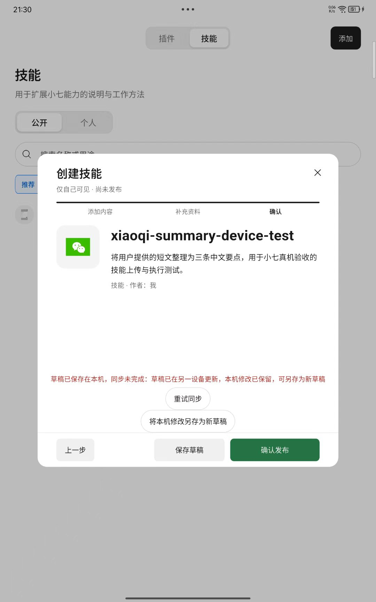
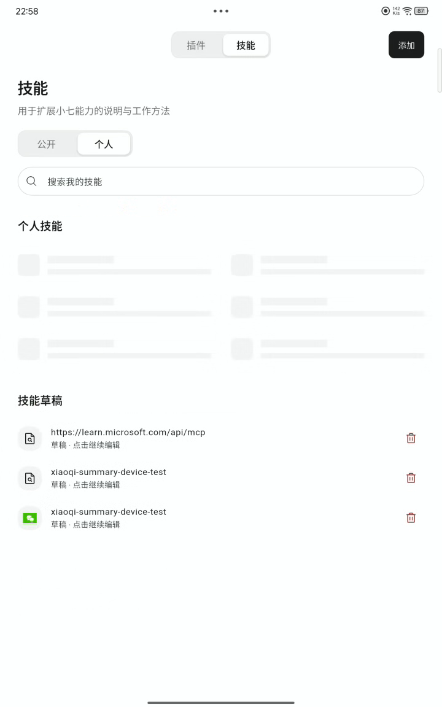
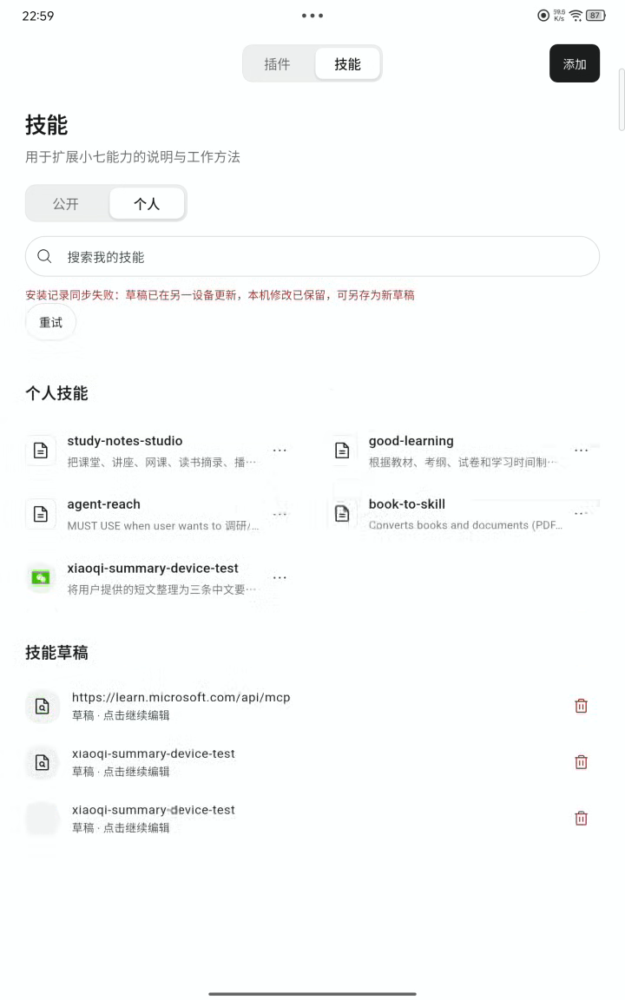
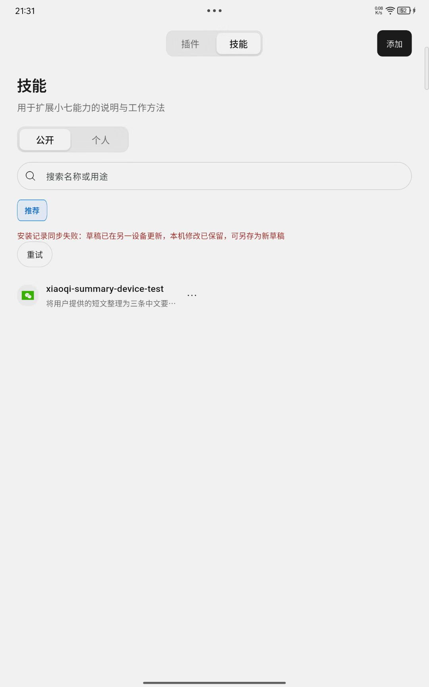
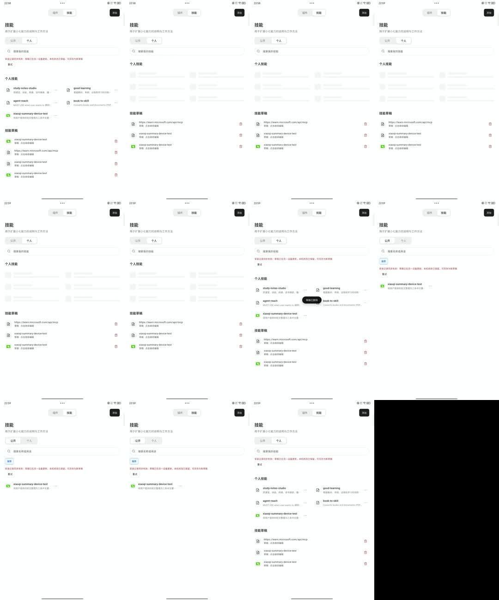

# 草稿保存与技能／插件列表刷新：根因及修复方案

日期：2026-10-24（Asia/Shanghai）。状态：诊断及待确认方案，未实施。

## 先看结论

两个问题共用一条有缺陷的同步链：**读取列表会执行全量草稿同步；一份草稿冲突会中断后续安装记录同步；页面在整个过程中隐藏已有列表，换成骨架屏。** 因此不能只修删除回调或增加一个缓存。

草稿本身还有独立问题：编辑器与后台可以同时上传同一草稿；重试沿用旧版本；界面把“本机保存”和“云端同步”混在一起，又把所有版本冲突说成“另一设备修改”。

建议先修同步隔离及同草稿并发，再修保存反馈和列表刷新表现。保留已确认的手动保存边界；退出保护、状态展示等交互变更须确认后实现。

## 1. 证据与边界

### 本次实际检查

| 步骤 | 来源／状态 | 判断 |
| --- | --- | --- |
| 1 | 用户截图：确认页保存后出现草稿冲突，保留保存／发布／重试／另存按钮 | 恢复路径不清楚；本机保存与云端冲突混为一条长红字 |
| 2 | 视频第 5.0 秒：个人技能被骨架替换，草稿列表仍在 | 已有数据被全局加载标记遮住 |
| 3 | 视频第 12.0 秒：列表恢复，重新出现草稿冲突的全局报错 | 列表与草稿错误被错误耦合；不是单纯“列表没数据” |
| 4 | 用户截图：公开技能页出现“安装记录同步失败：草稿已在另一设备更新” | 草稿错误泄漏到无关列表／公开视图 |

录屏 720×1152、21.1 秒、211 帧，取帧按解码帧序号和时间戳核对。两张原始截图为 1080×1728。这里只对用户提供的状态审计，不声称重新操作设备复现了完整流程。

查看保存与同步冲突截图

查看视频第 5 秒的列表加载状态

查看视频第 12 秒的列表恢复与报错

查看公开页错误与录屏采样

源码基于本地 HEAD `a1246ef` 及当前未提交工作区。已有未提交 UI 改动被保留。本次没有修改应用、服务端或 API。

**已证实的是代码中的阻塞、并发、重复刷新和错误归属问题。尚未证实的是这次 409 的具体触发者，以及录屏中每个 HTTP 请求的实际耗时。** 没有对应账号的请求追踪和当时客户端草稿快照，不能断言发生了真实跨设备编辑，也不能把 21 秒录屏当成无限循环的证据。

## 2. 草稿问题的根因

### A. 同一份草稿存在两条上传通道，没有共用网络队列

| 证据 | 实际行为 | 影响 |
| --- | --- | --- |
| `capability_cloud_sync.dart:688` | 全局 `_sync()` 遍历草稿并上传 | 页面、启动、应用恢复等都会触发 |
| `market_skill_editor.dart:574`、`:726` | 保存和重试直接调用 `syncAuthoringDraft()` | 可以与全局同步交错 |
| `capability_store.dart:39` | `_writeAuthoring` 只串行化本机存储写入 | 已有保护有效，但不覆盖 HTTP 请求或编辑器内存状态 |
| `capability_store.dart:115` | 保存时直接用传入对象替换该 ID | 编辑器旧对象可能把本机已获知的较新云端版本元数据写回旧值 |

可以由源码推演的同设备时序：后台拿到草稿 A、版本 3 开始上传 → 用户在编辑器保存 B，仍携带版本 3 → A 先成功成为版本 4 → B 收到 409，远端 A 与 B 不同 → 被当成“另一设备修改”。

这是可产生误导冲突的代码路径，并非本次录屏请求的实测重放。现有 `applySyncedAuthoringDraft` 已能保留请求期间另存的本机内容；应继续复用，不能把它误判为完全没有并发保护。缺口在上传协调、旧元数据回写以及编辑器状态更新。

### B. 版本冲突没有可完成的普通重试路径

`syncAuthoringDraft()`（`capability_cloud_sync.dart:1528`）使用 `draft.cloudRevision` 作为 `expected_revision`。收到 409 时，仅当远端内容指纹与待上传内容相同才承认为成功；其他情况抛出 `SkillDraftConflict`。

`_retrySync()`（`market_skill_editor.dart:723`）再次发送 `_base`，没有获取最新已保存状态、重新判定冲突或处理版本基线。远端内容仍不同时，点击“重试同步”会再次使用过时条件。

服务端 `api.dart:1956` 的版本检查是在防止覆盖新内容，不能删除这项检查来“修好保存”。缺少的是安全的客户端协调与冲突处理。

### C. “另一设备更新”没有证据支持

`SkillDraftConflict.toString()`（`capability_cloud_sync.dart:22`）是固定文案。云端已删除、普通版本过期、同设备请求竞争等情况也会进入这类异常；异常本身并不包含已核实的设备身份。

应改成中性的“云端版本已变化”，并用结构化原因区分版本冲突、已删除、鉴权失败和网络失败。

### D. 保存、同步、退出和发布的 UI 状态相互混淆

| 当前行为 | 问题 | 建议 |
| --- | --- | --- |
| `_persistDraft` 先本机写入，再等待联网同步；整个过程 `_busy=true` | 用户点击“保存”却被网络及可选 MCP 请求长时间阻塞 | 本机写入成功立即确认，云同步独立进行 |
| 本机成功、云同步失败时返回 `true` 并显示长红字 | 内部 bool 无法表达不同结果；用户不清楚内容是否安全 | 用明确结果类型，分别表达本机写入和云端状态 |
| 冲突同时显示“重试同步”和“另存” | 用户容易反复点击不会解决冲突的按钮 | 网络失败才重试；版本冲突进入专门处理 |
| 发布按钮仅按 `_locked` 禁用，未体现冲突；点击后又保存，随后因冲突返回 | 按钮外观与实际可完成动作不一致 | 冲突时在按钮旁解释原因并禁用发布 |
| `_leave()` 直接退出 | 这是当前确认稿规定的行为，但缺少对未保存修改的临近提醒 | 建议增加有修改时的退出确认，保留手动保存边界 |

当前 `_publishInPlace()` 在同步失败／冲突后会停止发布（`:1490`）。因此问题是按钮反馈及重试行为，不是已经证实“冲突后仍可成功发布”。

现有确认稿 `creation-modal-final-2026-10-24.md:16`、`:29` 规定只有显式保存／发布才持久化，关闭丢弃本次未保存修改；`:26` 还规定从作品编辑入口恢复作品当前版本，显式点草稿才继续草稿。这些属于已确认边界，本方案不把它们误报成数据恢复 bug，也不擅自改为自动保存。

## 3. 列表长时间刷新问题的根因

### A. 读取列表，被实现成一次全量同步事务

`extension_market_page.dart:503` 的 `_reload()` 会：

1. 把 `_loading` 设为 `true`，清除错误。
2. 读取本机记录和草稿，写入页面状态。
3. 有未同步记录时先执行一次 `syncNow()`。
4. 再无条件执行一次 `syncNow()`。
5. 等待完成后才结束 `_loading`。

第 2 步虽已拿到可展示的本机数据，页面 `:1693`、`:1710`、`:1745` 仍因 `_loading` 返回整块骨架。

一次全局同步（`capability_cloud_sync.dart:623`）又串行执行：读取所有云草稿 → 处理删除队列 → 上传每份草稿 → 上传待同步能力记录 → 读取能力列表。草稿请求有 45 秒超时，其他请求有 20／25 秒超时；每个请求单独限时，整轮没有统一预算。数据越多、网络越慢，等待越长。

这些超时值是代码配置，不是视频实测耗时。45 秒也不是整页最长等待时间。

### B. 一份草稿冲突会中断所有后续步骤

草稿循环没有逐项捕获并隔离 `SkillDraftConflict`。冲突一旦抛出，后面的能力记录同步和 GET 列表都可能不执行。

页面捕获全部异常后统一拼成“安装记录同步失败”（`:551`），并在公开／个人视图共同区域显示（`:1678`）。两张截图的错位报错与这条代码路径完全一致。

安装记录还有一处确定的不一致：页面 `hasUnsyncedLocal`（`:521`）把 `conflict` 算成需要同步；同步器（`capability_cloud_sync.dart:695`）却明确跳过 `conflict`。于是即使没有草稿冲突，这类记录也会让页面在每次刷新后再次报“本机修改尚未完成同步”。应把待上传、需要用户处理的冲突、已同步分开，冲突不能继续作为列表读取的前置条件。

### C. 多个入口放大重复刷新，并非删除专属

| 入口 | 位置与重复点 |
| --- | --- |
| 进入市场 | `initState:458–461` 同时启动记录、MCP 连接、MCP 目录、公开作品四项读取；技能页也会启动 MCP 请求 |
| 编辑／导入返回 | `_edit:717–718` 无论是否修改都刷新记录及公开作品；外层 `_import:696` 还可能再刷新一次 |
| 安装／启停／详情管理 | 安装 `:810`、启停 `:987`、详情回调 `:916` 等复用整页 `_reload()` |
| 移除／删除草稿 | `_remove:855–863` 可能先同步再刷新，失败后再次刷新；`_deleteDraft:1251` 也走全量同步 |
| 启动／应用恢复／聊天入口 | `home_page.dart:638`、`:653`、`:4414` 和聊天选择器也会调用全局同步 |

`syncNow()` 在已有任务时会设置 `_syncAgain=true`（`:608`），共享的是当前任务及其后续补跑轮次；不是简单等待现有请求结束。持续有调用加入时，do/while 可持续补跑全量同步。没有新调用且每轮请求都结束时，源码不构成必然永久运行的循环。

此外，页面 `_reload*()` 没有统一的同源请求合并与响应代次保护；可能出现重叠请求、较旧结果后到及加载状态互相覆盖。

### D. 缓存只解决其中一部分

能力记录已有本机缓存，但页面加载标记遮住了它；公开作品、MCP 连接和目录主要保存在当前页面 State，重新建页便重新加载。应同时解决：缓存展示、请求去重、按范围刷新、同步错误隔离。只延长缓存时间会留下阻塞和冲突路径。

## 4. 具体修复方案（待确认后实施）

### 4.1 草稿：统一写入和同步入口

沿用现有 `CapabilityStore`、指纹及安全存储，不为这次修复引入同步框架或全面更换数据库。

1. 增加按“账号＋草稿 ID”工作的协调器。显式保存、后台补传、聊天草稿与发布前同步都经过它；同一草稿同一时刻只有一个上传，期间新保存只更新下一份待发快照。
2. 本机写入保留最新已知云端 revision／同步基线，禁止编辑器旧对象降低这些元数据。收到响应只确认对应快照；已有新内容时保留新内容及待同步状态。
3. 仅上传已保存且内容发生变化的草稿。同一套规范化内容指纹排除 `updated_at`、云 revision 和本机元数据；服务端也按同一语义判定无变化，避免只更新时间就产生新版本。
4. 将网络失败、版本冲突、云端删除、鉴权失效分开持久化到对应草稿；单项失败继续处理其他草稿和安装记录。相同失败不因打开列表自动反复提交。
5. 发布前只等待当前草稿的已保存快照同步成功；确认没有更新的本机修改后才发布。保留原有作者权限、凭据私有和公开版本隔离。

普通“重试同步”读取最新**已保存**版本，不偷偷保存表单里的未保存修改。未保存内容仍只在用户点击保存／保存后退出／确认发布时持久化。

### 4.2 后端：保留防覆盖，补齐幂等和错误分类

| 项目 | 具体规则 |
| --- | --- |
| 防覆盖 | 保留 `expected_revision` 检查；不同内容且基线过期继续拒绝 |
| 幂等 | 同一保存快照使用稳定 `mutation_id`；超时后的原请求重试可识别已成功写入；同一 ID 携带不同内容须拒绝 |
| 无变化 | 规范化后的业务内容相同时返回现有草稿及 revision，不因本次客户端时间不同增加版本 |
| 错误 | 返回明确 code，如 `draft_revision_conflict`、`draft_deleted`；携带当前版本及规范化内容 hash，不声称知道修改设备 |
| 发布要求 | 同步／发布使用明确快照；如修改请求／响应契约，客户端、服务端与共享契约版本同一发布更新 |

冲突处理：远端与已发快照内容相同，承认为已同步；远端仍等于已知同步基线，可在最新 revision 上安全重提本机变更一次；两边内容都改变时停止自动覆盖，保留双方并让用户选择。不能仅把版本号改成最新后强制 PUT。

选择“使用云端版本”前重新读取，替换本机前明确确认；选择“另存本机副本”创建新 ID，并保留原云端版本。云端删除单独提示，可把本机内容另存，不自动复活已删除草稿。MCP 凭据继续使用安全存储／私有连接，不进入公开草稿或诊断日志。

### 4.3 UI：保留三步结构，明确每次保存的结果

状态放在弹窗标题“仅自己可见／尚未发布”附近的固定位置，避免在大段空白末尾堆叠长错误和按钮。保留现有黑白灰及成功绿，不改三步导航或 SVG 资产系统。

| 状态 | 用户看到 | 可执行操作 |
| --- | --- | --- |
| 有未保存修改 | “有未保存修改” | 保存草稿；关闭时确认 |
| 本机保存成功／后台同步中 | “已保存在本机 · 正在同步”＋最后保存时间 | 继续编辑、关闭；同步不锁住整个编辑器 |
| 断网／临时失败 | “已保存在本机 · 等待同步” | 重试已保存版本；继续编辑 |
| 内容冲突／云端已删除 | “本机内容已保留 · 云端版本已变化／已删除” | 处理冲突；不继续显示无效的普通重试 |
| 同步成功 | “已同步”＋最后保存时间 | 无新修改且校验通过时确认发布 |

“保存草稿”保持显式点击，成功后留在当前步骤；本机写入失败必须显示“未保存成功”，保留输入及打开状态。普通成功仍用现有短暂 `AppToast`，持久状态承接后续反馈。

实现时用单一明确状态及结果模型替代互相独立的 `_syncFailed`／`_draftConflict` 等组合。当前 `_retrySync` 成功分支（`:729`）只清 `_syncFailed`，没有同时清 `_draftConflict` 和 `_remoteDraft`，存在同步已成功但仍展示冲突操作的残留状态。

关闭有未保存修改的编辑器时，建议显示“有未保存修改”，提供“保存后退出／不保存退出／继续编辑”；无修改直接关闭。保存后退出只等待本机写入，不等待联网同步；本机写入失败不退出。此为新增交互提案，须确认后修改现有关闭规则。

个人草稿行补“最后保存时间＋本机／待同步／冲突状态”，解决同名草稿难区分的问题。冲突只挂在该草稿及其编辑器，不显示到公开市场或无关安装列表。确认发布在冲突时禁用，并说明“先处理此草稿的同步状态”。

继续遵守全局输入焦点规则：点击保存／关闭本次即执行；空输入主动收键盘时退出焦点；有内容仅收键盘不强制失焦。错误使用文本及可读标签，不能只靠红色；重要状态以语义通知播报，避免每次 rebuild 反复报“正在加载”。读屏与焦点行为仍须设备验收。

### 4.4 列表：缓存先显示，后台只刷新相关集合

1. 将“读本机缓存”“取云端列表”“补传待同步修改”拆成独立操作；列表 GET 不再等待草稿上传。已有内容始终可见，仅无任何缓存的首次读取展示静态骨架。
2. 复用数据层维护账号隔离的快照。建议公开作品／MCP 目录 5 分钟有效，个人安装／连接 30 秒有效；缓存过期仍先显示内容再更新。这些是建议初值，需用请求耗时记录调优。
3. 按集合合并进行中的相同 GET；普通页面进入不排下一整轮同步。只有实际发生新修改才补传下一批，冲突项不自动重试；使用请求代次和账号／release 校验拒绝过时响应。
4. 编辑弹窗返回明确结果（取消、仅保存草稿、发布、修改连接）；取消不刷新，保存只更新草稿，发布才更新相关作品及安装记录。删除本机成功立即移除对应行，保留删除标记到云端确认，失败单独提示待同步，不能被旧响应复活。
5. 按当前技能／插件视图懒加载；保留查询、滚动位置及已选分段。后台刷新失败保留已有内容和上次更新时间，只在对应集合展示重试；每个请求有超时，任何失败都结束该请求的刷新状态。

缓存键包含账号、数据集合及契约／release 边界；退出账号清理私有缓存。契约不匹配仍按现有规则停止相关 API 操作并显示客户端／服务端版本，不用缓存掩盖不匹配。搜索维持本机筛选，不为输入每个字符发全量同步请求。

## 5. 实施顺序、验收与研究依据

### 实施顺序

1. 确认上面的保存状态、关闭确认及冲突处理提案，补入 DESIGN／本次交互规格；冻结本轮范围。
2. 修草稿协调器、逐项失败隔离、幂等及错误契约；客户端与服务端一起更新。
3. 修列表读取、缓存展示、请求合并和操作后的定向更新；接入保存状态 UI。
4. 完成自动检查后按单版本发布流程部署并做服务健康／数据检查，再交付客户端真机验收。

工程量估算：确认交互后，前后端修复与自动检查约 1 个工作日；真机主路径验收约 15–25 分钟。部署耗时取决于 CI、授权及远端检查，不把它算成已经完成。

### 必须覆盖的验收组（尚未执行）

| 验收组 | 必须满足 |
| --- | --- |
| 保存与退出 | 三步往返内容不丢；手动保存后重开一致；有修改退出按选择执行；本机失败不显示已保存；断网保存不等待云端 |
| 并发与冲突 | 人为延迟后台 A 响应期间保存 B；B 不丢、不降 revision；同设备请求串行；真实双端冲突保留双方；云端删除有独立状态；超时后重试不重复变更 |
| 列表与缓存 | 已有缓存时无全块骨架；安装、启停、保存、取消、返回、重试和恢复前台均覆盖；同一集合只有一个进行中的 GET；旧响应不覆盖新结果；失败结束刷新 |
| 隔离与既有数据 | 冲突草稿不阻止其他草稿及安装记录；删除成功不复活；老草稿、附件、介绍图片和 MCP 私有连接可继续使用；账号切换不串数据 |
| 发布及可访问性 | 发布只用明确保存的当前快照；草稿不改变既有公开版；契约不匹配正确阻止；触控、键盘、读屏、焦点及非颜色错误提示通过目标平台验收 |

建议增加只含元数据的观测：request ID、触发入口、集合、草稿脱敏 ID、expected／actual revision、规范化内容 hash、请求耗时、结果类别、是否缓存命中及是否合并。记录中不得包含正文、图片、令牌或账号明文。它用于确定录屏中究竟哪项请求慢，以及此次 409 属于哪条时序。

### 外部一手参考（2026-10-24 检索）

| 来源 | 版本／时间／许可 | 本项目采用的原则 |
| --- | --- | --- |
| [Flutter：Offline-first support](https://docs.flutter.dev/app-architecture/design-patterns/offline-first) | 当日官方文档快照 | Repository 统一访问本地与远端；本机保存与同步分离；只作架构参考 |
| [RFC 9110 §13.1.1](https://www.rfc-editor.org/rfc/rfc9110.html#section-13.1.1) | 2022-06，HTTP Semantics | 条件更新防止丢失更新；本项目可继续用现有 revision 契约，无须为此改用 ETag |
| [Joplin 同步设计](https://joplinapp.org/help/dev/spec/sync/)／[GitHub](https://github.com/laurent22/joplin) | dev；仓库 pushed_at 2026-10-23；[总许可](https://github.com/laurent22/joplin/blob/dev/LICENSE) AGPL-3.0-or-later，子目录可另有许可 | 集中同步器、逐项同步状态、仅处理需要同步的项目；不复制其代码或引入依赖 |
| [PouchDB 冲突指南](https://pouchdb.com/guides/conflicts.html)／[GitHub](https://github.com/apache/pouchdb) | master `27de91f1105a`，提交 2026-08-25；Apache-2.0 | 冲突要基于新状态和可安全重放的变更处理；整份编辑文档不能简单循环覆盖；不复用代码 |

### 本次交付状态

| 项目 | 状态 |
| --- | --- |
| 截图／视频及代码诊断 | 已完成；结构性根因有代码定位，事件级请求耗时与冲突来源仍待日志 |
| 修复代码／API 变更 | 未实施；本次仅提供方案和证据 |
| 自动化检查／同状态修复后视觉对比 | 未执行，无修复版本可验收 |
| 真机／目标平台验证 | 未执行验证，待用户真机验证；未操作已连接设备；ARTEMIS 工具未提供，按项目规则跳过其流程 |
| 服务端发布 | **server deployment not needed**：本次未改服务端、部署文件或 API；公开健康探测遇到本机 TLS 证书验证失败，未据此断言线上服务异常，也未验证生产健康 |

下一步：确认采用“显式保存后立即确认本机结果、后台独立同步、未保存退出时确认、冲突仅在对应草稿处理”的交互方案。
