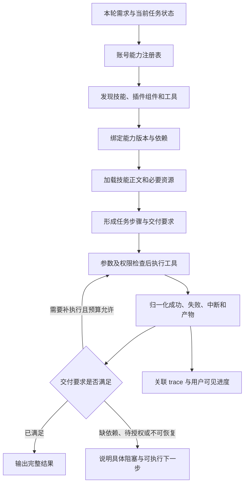

# 小栖 Agent 技能、插件与 MCP 全链路修复方案

日期：2026-10-19。状态：实现和服务器发布已完成，真机待用户验证；验收证据见[实施记录](../diagnostics/agent-capability-chain-implementation-2026-10-19.md)。代码审计基线：`ac9b23e`，并追查相关能力改动的提交历史。

**目标：用户说清需求后，Agent 能发现、加载和执行合适的能力，交付真实结果；已明确选中的技能、插件和 MCP 在同一任务的后续追问中继续生效。**

本方案针对整个运行链，不以 `study-notes-studio` 的名称、专用关键词或单个技能补丁作为解决方案。该技能只是用户提供的复现案例。

## 1. 已确认的产品约定

1. 同一任务内，已选技能和 MCP 持续生效，直到用户明确移除或切换任务。插件及其已激活组件按相同作用域管理。
2. 用户不必每轮重新插入标签；“用它整理”“继续”“补上图片”等追问要承接当前任务。
3. 用户提出具体需求时，应主动发现相关能力。发现、加载能力不等于自动授权外部写入、付费或其他副作用操作。
4. “安装成功”“可用”“已加载”“执行成功”“产物已交付”分别表达，不相互替代。
5. 当前已获实施授权：完成客户端与服务端修改、自动化验证及服务器部署；用户负责新版客户端的真机验收。具体完成状态以实施记录为准。

建议的首轮范围：修复当前技能、插件技能组件、隔离脚本、内置工具与远程 HTTPS MCP 的完整闭环，并补全插件依赖关系和组件状态。任意桌面客户端专有 API、宿主 hooks、任意本地进程启动不因本次修复而默认获得执行能力；这些组件必须明确标明支持边界，不能被包装为全部可用。

## 2. 证据与断点

### 2.1 视频与当前代码相互印证的路径

视频 `00:00–00:01` 显示：用户先发送 `book.pdf` 和 `study-notes-studio` 标签；助手回复能力介绍，并建议用户说“请用它帮我整理这份资料”。下一条用户消息确实照此发送，且可见消息没有再次附加标签。

当前实现中的对应路径：

```text
只发送技能标签和附件
  → capability_only 分支介绍能力后返回
  → 用户照提示发送“请用它帮我整理这份资料”
  → 普通技能没有任务级选中状态，当前输入框也已清空
  → 当前消息没有 capabilityMetadata
  → 客户端发送 selected_capabilities: []
  → 服务端创建空 SelectedSkills，不挂载技能中间件
  → 有附件时可能进入普通附件回答路径
```

代码依据：`home_page.dart:2114–2149、2198、2691、2788`；`agent_runtime.dart:1247–1278、1488–1496、2452–2453`。服务端 `api.dart:805` 只在整份回合配置缺失时继承历史配置，普通追问携带的新配置不会走该分支。

**这是当前代码可确定的缺陷，也与录屏顺序一致；尚未取得录屏对应线上请求与 trace，因此不把它声称为该次线上故障的唯一原因。**

### 2.2 需要修复的通用问题

| 优先级 | 问题与具体影响 | 主要代码位置 | 修复要求 |
|---|---|---|---|
| P1 | 保留普通技能、插件和 MCP 的跨轮选择。当前只对创建/修改技能的特殊 action 保持 `_activeSkillWorkflow`，用户按助手提示继续提需求时会丢掉普通扩展选择。 | `lib/pages/home_page.dart:2116、2146、2788` | 使用任务作用域状态，并区分“未修改”和“明确移除”。 |
| P1 | 恢复可发现的能力目录。当前 `SelectedSkills` 只接受当轮显式选择；没有选择就不挂载 `skills()`。提示词要求自动选技能，却没有向模型提供对应目录与加载入口。 | `selected_skills.dart:11`；`agent_runtime.dart:1275、2452` | 按账号、启用状态及授权构建可发现目录，再将选中的能力绑定到当前任务。 |
| P1 | 最终回答前校验实际交付。准备阶段可以不读取技能就结束，最终阶段 `toolNames: []` 无法补执行；现有证据检查只针对已加载且包含脚本的技能。纯指令技能、未加载技能、缺图片/文档等可能漏检。 | `agent_runtime.dart:2529、2590`；`api.dart:1079–1099` | 显式选择必须先成功加载；按任务交付要求验证产物，未满足时恢复执行或报告具体阻塞。 |
| P2 | 在确认 MCP 业务结果前不要发布成功。`callTool` 正常返回便发出 `tool_succeeded`；后续中间件虽然识别 `isError`，但展示状态机对已经结束的记录忽略 `tool_returned`，失败无法覆盖先前成功。 | `agent_runtime.dart:1634–1642`；`agent_presentation_middleware.dart:168`；`public_agent_process.dart:140–141` | 由统一结果归一化层确定最终状态；业务错误和传输错误均须保留真实分类。 |
| P2 | 保留 MCP 多模态产物。整个 MCP 结果被转为字符串，并在 80,000 字符截断；图片、音频及内嵌资源没有在该适配路径中转换成完整的用户产物。 | `agent_runtime.dart:776–780、1642` | 按结果类型处理；完整媒体进入产物存储，文本摘要与媒体交付分开。 |

上表相对路径均以项目根目录为基准；三个无目录前缀的服务端文件位于 `xiaoqi_harness/genkit_server/lib/src/`。技能选择与证据检查主要来自 `b50a3d0`，MCP 适配来自 `cf85d57`，回答阶段拆分来自 `8289f7a`。

不能由此推断“Genkit 不会读取技能”：本项目锁定 `genkit_middleware 1.0.0`，其 `use_skill` 会返回完整技能正文。若调用已经成功，正文可通过工具历史传给后续生成；本次没有证据证明它必然被丢弃。需要修复的是加载保证、阶段衔接和完成判定。

### 2.3 插件也在问题范围内

**当前实现主要支持插件中的技能组件，并不等于完整运行整个插件包。**

`capability_import_service.dart:419–445` 扫描插件内的 `SKILL.md`，把 MCP、hooks、commands、agents、apps 等列为不支持的组件；安装时仅把可接受的技能组件加入组件记录。`selected_skills.dart:26–54` 再把这些组件展开为技能，接入同一条执行链。

因此，插件包含两个不同层面的问题：

- **通用执行缺陷**：插件技能组件同样受到跨轮选择丢失、无法自动发现和交付验收缺失的影响。
- **宿主支持边界**：内置远程 MCP 连接器已经存在，但插件声明的 MCP 没有形成插件依赖到连接器的绑定链；其他宿主专有组件也没有适配。这是明确的支持缺口，不能全部称为新回归，也不能靠一句“插件已安装”消除。

现有导入器已经有 `partial / unsupported` 和警告信息，不能说完全没有兼容性检查。需要补的是：组件依赖进入任务运行决策、缺失关键组件时及时阻塞，以及包级状态与实际可用组件一致。

截图中的 `study-notes-studio` 自身显示为“技能”，不能用该截图证明某个插件包的 MCP 或 hook 已发生调用失败；插件问题由代码路径独立确认。

## 3. 目标执行链



模型负责理解需求和规划工具调用。运行层负责真实能力目录、版本与权限约束、工具执行及交付证据。能力不存在、连接不可用、暂未授权、执行失败、尚未调用是不同状态，不能由模型统一归因为“我没有能力”。

## 4. 分层设计

### A. 任务状态：先保证后续追问不丢能力

当前每次发送都会创建新的 `taskId`，它实际承担每轮执行标识。建议另设稳定的 `workflow_id` 表达用户意义上的同一任务，现有每轮任务继续承担执行与 trace 关联，避免把两个生命周期混在一起。

建议保存三组状态：

| 状态 | 建议内容 | 生命周期 |
|---|---|---|
| 任务能力状态 | 已选技能/插件/连接器、来源、固定版本、明确移除项、状态修订号 | 同一任务持续有效 |
| 已激活上下文 | 成功加载的技能与资源摘要、依赖关系、交付要求 | 随任务保存；必要时按固定版本重新加载 |
| 每轮执行记录 | 当前需求、可用工具快照、调用、错误、授权结果、产物 | 当前回合；关联到任务 |

能力变更使用明确操作，如添加、移除、清空；缺少变更字段表示继承。不要继续用 `[]` 同时表达“没有重新选择”和“用户取消全部能力”。服务端校验账号、启用状态和版本，客户端只提交用户意图。

建议把“换任务”落实为显式新建聊天/新任务；在同一聊天中如需另起任务，使用明确操作。不能仅因模型判断话题变了就静默清空。取消一轮执行保留任务能力；删除能力或其凭据失效时，后续执行须重新检查。

历史分支应继承分叉点的任务状态，不能继承另一个分支最新选择。移除能力应立即影响后续调用；保留过去的执行证据，不把历史记录误当当前授权。

### B. 能力注册表：区分发现、加载与执行

统一登记技能、插件、MCP 连接器和内置工具，但保留各自类型与执行方式。建议字段包含：身份与版本、描述和触发语义、账号与作用域、依赖、支持状态、健康状态、执行器、输入输出契约。

目录构建规则：

1. 显式选择：运行层解析精确版本并加载正文；不能再次把“是否读取”交给模型决定。
2. 已激活任务能力：后续追问恢复目录、正文和执行器绑定，保持移除决定。
3. 未显式选择：按描述检索当前账号已安装、启用且允许发现的能力；确实相关时加载。
4. 多个候选会显著改变结果时才澄清。普通需求不要求用户先了解技能名称。
5. 加载只赋予上下文，不放大权限；执行阶段仍核验授权。外部文档和技能资源不能修改注册表或授权状态。

目录较少时直接注入精简元信息；较多时提供运行层的搜索与按需加载工具。先使用现有存储和 Genkit 注册机制，不为此引入第二套 Agent 框架或默认增加向量数据库。不能假定 DeepSeek 支持 OpenAI/Anthropic 专属的原生延迟工具接口。

### C. 插件组件与依赖：从安装包接到真实执行器

插件是带版本的能力集合，不是单一工具，也不只是几个显示名称。建议将插件清单解析为组件与依赖图，保留原始清单供追溯。

| 组件 | 建议执行方式 | 缺依赖时的行为 |
|---|---|---|
| 技能与引用资源 | 接统一技能加载器，绑定插件版本及组件 ID | 加载失败时阻塞依赖该组件的步骤 |
| 已支持的隔离脚本 | 复用现有沙箱与版本绑定，不执行任意宿主路径 | 明确缺运行时/依赖包，不改写成“没有这个技能” |
| 可适配的远程 HTTPS MCP | 解析声明并绑定账号连接记录；完成必要登录、发现工具和权限检查 | 待连接或待授权；不默默把依赖丢弃 |
| commands / agents | 只有明确语义适配器时暴露相应入口 | 未适配时标记不支持，不把任意文本命令当已实现功能 |
| hooks、桌面专有 API、任意本地进程 | 需要单独的宿主生命周期与执行边界设计 | 保留明确支持状态，本轮方案不承诺自动运行全部组件 |

插件包级状态由组件状态与依赖关系汇总：独立可用功能可继续；当前请求必需组件缺失则先报告阻塞。不得因为一个可选组件不可用而拒绝所有功能，也不能因为一个技能可读就宣称整个插件可运行。

卸载、停用、升级插件时同步处理组件索引、任务绑定和连接引用；被多个插件共享的连接不能随一个插件卸载而误删。新版本只影响新的绑定，正在执行的任务版本保持固定。

### D. 技能执行：把要求转为可检查的工作步骤

正文加载成功后记录证据，再按需读取所需资源。保留受支持的元数据与触发限制；对不能解释的宿主专有字段记录兼容性，不在重写 `SKILL.md` 时无声抹掉其含义。

建议让模型根据用户请求与技能形成结构化计划，由运行层验证执行器和权限。计划至少表达：必要步骤、必要工具或依赖、产物类型与数量、允许的澄清和失败出口。Markdown 不能可靠地静态推导所有要求，计划不应伪装成已执行证据。

显式选择后未加载技能、未取得必要资源、所需产物缺失，均不能默认完成。技能可要求图片、PDF 或其他产物，不以是否包含 `scripts/` 判断是否需要验证。

准备/回答两阶段可以保留，但必须共享已激活技能、工具证据和交付要求；只有验收通过后才进入无工具的最终输出阶段。需要补执行时回到执行阶段，保持调用预算、幂等和已完成步骤，避免重复收费或重复外部写入。

现有生图路径还有“本任务成功生成一次后拒绝再次生成、每次 count=1”的限制。多页交付不能仅检查“有一张图片”；建议按产物/页建立幂等键和预算，在确需多页时逐项完成。该限制作为能力边界纳入方案，不冒充本次新发现的回归。

### E. MCP 与内置工具：统一结果、状态及产物交付

建议以内部工具结果结构统一表达：状态、错误类别、是否可重试、可供模型使用的文本/结构化数据、产物引用、待用户操作。不同供应商适配器负责转换，模型不直接处理被截断的原始媒体包。

| 环节 | 建议规则 |
|---|---|
| 发现 | 完整处理 `tools/list` 分页；按连接、凭据和目录版本缓存；响应目录变更或在重新连接时刷新 |
| 执行 | 参数验证、权限检查、超时与取消一致；不自动重试可能已经产生副作用的调用 |
| 结果 | RPC 正常返回不等于成功；先检查 `isError`、结果结构和必要产物，再发布终态 |
| 媒体 | text、structuredContent、image、audio、resource、resource_link 分别处理；完整数据不做字符串硬截断 |
| 交付 | 图片/文件进入受保护产物存储和现有客户端产物通道；资源链接依据协议及授权读取或展示，不因 URL 存在就视为已下载完成 |

模型上下文可使用有边界的摘要和资源引用，日志可裁剪；真实产物不能裁剪。对不支持的 MIME、过大结果或无权读取的资源，保留明确错误和可恢复状态。

同一次调用只由一个状态归一化入口发布最终结果。展示层可以去重，但不能把错误拦在已经误报的“完成”状态之后。

## 5. 用户可见交互建议

复用已有标签、过程区域、授权卡片和产物展示，设计阶段确认以下状态后再实施，不重造一套界面：

| 场景 | 用户应看到的行为 |
|---|---|
| 已选择技能/插件/MCP | 当前任务持续显示已选能力，可移除；后续提问无需再次插入标签 |
| 自动匹配能力 | 在过程区域显示实际采用的能力；不得把推荐写成已经执行 |
| 插件部分可用 | 显示哪些功能可用、当前任务缺哪项依赖及下一步；不只给包级“已安装” |
| 加载与执行 | 分别显示读取技能、读取必要资料、执行工具；状态来自真实事件 |
| 失败/取消/恢复 | 展示具体失败环节和已完成产物；取消不清空任务能力，恢复不重复已完成副作用 |

保持现有无障碍标签与键盘/读屏可操作性。页面跳转和数据读取使用静态占位，不新增转圈过渡；正在进行的任务反馈按项目既有规范处理。

## 6. 验收：验证闭环，而非只验证工具列表

### 必须通过的用户路径

| 用例 | 必须出现的证据 |
|---|---|
| 标签＋附件 → 能力介绍 → “请用它整理” | 同一 workflow、相同能力版本；正文加载事件；按技能交付 |
| 插件选择 → 普通追问 → 依赖 MCP | 插件组件解析、依赖绑定、工具发现及实际调用相互关联 |
| 未选标签，提出明确相关需求 | 目录发现、匹配理由、技能加载、必要工具调用；不依赖技能名字硬编码 |
| 移除能力/新任务/历史分支/取消后恢复 | 作用域和版本正确；已移除能力不再执行；其他分支不受污染 |
| 需要图片/PDF/多页结果 | 对应数量与类型的真实产物可访问、可渲染；文字规格不算成品 |

### 必须通过的故障路径

| 用例 | 必须出现的证据 |
|---|---|
| 技能正文不存在、资源读取失败或版本失效 | 具体加载错误；不能跳过后声称按技能完成 |
| 插件关键依赖缺失、可选组件不支持 | 依赖此组件的步骤明确阻塞；独立可用功能仍正确识别 |
| MCP `isError:true`、断连、授权拒绝、超时 | 状态及回答一致；错误不残留成功终态 |
| MCP 返回超过 80 KB 的图片/混合内容 | 产物完整；摘要有界；无 base64 截断导致的损坏 |
| 准备阶段漏调用、模型声称无能力或虚报完成 | 根据真实能力与交付证据纠正；能补执行则补，否则给准确阻塞 |

测试分层建议：状态与解析单测 → 使用可控假模型/MCP服务的运行层集成测试 → 真实模型与实际供应商的端到端回归 → 用户目标设备验证。涉及外部副作用的回归使用测试账号、隔离资源及受控预算。

每条 trace 关联任务、回合、能力版本、插件组件、工具请求、结果分类和产物 ID。日志不记录凭据或无关用户正文；用户界面只展示可理解的过程与结果。

验收不要求暴露模型内部思考。要验证的是实际行为、错误分类和交付物。

## 7. 实施顺序与风险控制

1. **确定任务状态与交互规格**：落实已确认的持续生效约定，确认移除/换任务/分支行为和插件部分可用展示；完成 Product Design 交互确认后冻结范围。
2. **实现统一注册与绑定**：任务状态、能力发现、显式技能加载、插件组件依赖在同一版本内落地；补上述跨轮复现用例。
3. **实现执行和产物闭环**：统一工具结果、MCP 媒体通道、交付要求和补执行；取消、权限和幂等同步验收。
4. **端到端回归后发布**：记录真实模型、工具和产物证据；统一客户端/服务端 release 与 API contract；通过检查后执行现有 `deploy_current.ps1`，验证健康与数据，失败自动回滚。

建议复用 Genkit、现有 CloudStore、不可变能力包、沙箱、权限与产物存储。先新增内部职责边界，逐步替换现有条件分支，避免另建平行执行引擎。

| 风险 | 处理与降级 |
|---|---|
| 自动发现误用技能 | 只发现允许范围；显式选择优先；歧义才澄清；发现不授予副作用权限 |
| 自动生图、多次调用增加成本 | 按用户交付需求设预算及产物幂等；超过预算明确停在待操作状态 |
| 能力或依赖在任务中途失效 | 调用前复核；保留已完成产物，阻塞相关步骤，不换用未授权版本 |
| 状态迁移误继承 | 以分支可见历史和显式状态为依据；无法确定的旧聊天只恢复可证明的选择，必要时一次澄清 |
| 发布影响既有数据 | 不改写历史产物和不可变能力包；迁移可回退；发布前保留唯一应急恢复点，验证后按项目规则清理 |

因为回合配置和任务作用域会改变，实施时必须同时修改 Flutter 与服务端契约。继续执行单版本策略，不增加长期旧请求兼容分支。服务器部署、客户端验证、真实效果验证分别记录。

## 8. 官方资料与成熟实现依据

核验日期：2026-10-19。以下均为架构/协议参考，本方案不复制外部实现代码。

| 来源 | 核验版本与许可 | 借鉴点 |
|---|---|---|
| [Agent Skills 官方接入指南](https://agentskills.io/client-implementation/adding-skills-support) | 在线文档；[仓库 Apache-2.0](https://github.com/agentskills/agentskills/blob/main/LICENSE) | 元信息发现、正文激活、按需资源读取；显式选择由宿主加载；上下文持续性 |
| [Genkit Dart 1.0.0](https://github.com/genkit-ai/genkit-dart/releases/tag/genkit-v1.0.0) | 2026-10-07，`ca9c90a`；Apache-2.0；本项目相关依赖为 1.0.0 | [Skills 工具实现](https://pub.dev/documentation/genkit_middleware/1.0.0/genkit_middleware/SkillsMiddleware/tools.html)、[目录注入实现](https://pub.dev/documentation/genkit_middleware/1.0.0/genkit_middleware/SkillsMiddleware/generate.html)、[MCP 结果处理](https://pub.dev/packages/genkit_mcp#tool-responses) |
| [MCP Tools 规范](https://modelcontextprotocol.io/specification/2025-11-25/server/tools) | 固定规范版本 2025-11-25；仅参考协议，不复制仓库代码 | 分页与目录变更、`isError`、结构化与多模态结果 |
| [OpenAI Agents Python v0.24.0](https://github.com/openai/openai-agents-python/releases/tag/v0.24.0) | 2026-10-15，`17d994b`；[MIT](https://github.com/openai/openai-agents-python/blob/v0.24.0/LICENSE) | [MCP 集成](https://openai.github.io/openai-agents-python/mcp/)的工具过滤、缓存与结果转换；[tracing](https://openai.github.io/openai-agents-python/tracing/)关联执行证据 |
| [study-notes-studio 原文](https://github.com/yxxx6666/study-notes-studio/blob/eabe1f070d218a60a7c59a12e0740f11c0fb7b49/SKILL.md) | 截图版本 SHA `eabe1f070d218a60a7c59a12e0740f11c0fb7b49`，文档版本 v1.4.1；[MIT](https://github.com/yxxx6666/study-notes-studio/blob/eabe1f070d218a60a7c59a12e0740f11c0fb7b49/LICENSE) | 仅作为复现规格：要求实际 AI 生图并读取相关手册，纯文字设计参数不能替代交付 |

OpenAI、Anthropic 的原生 tool search 可作为延迟加载模式的参考，但有各自模型/API条件。本方案不把这些专有接口当作当前 DeepSeek 模型已经拥有的能力。

## 9. 方案阶段的验证记录（历史）

已完成：查看两张用户截图及视频关键帧；核对相关客户端/服务端代码与提交；核验官方资料和固定版本技能原文。运行下列五个现有测试文件，33 项测试通过，进程退出码 0：

- `selected_skills_test.dart`
- `skill_tool_recovery_middleware_test.dart`
- `mcp_connection_service_test.dart`
- `agent_runtime_test.dart`
- `remote_agent_api_test.dart`

以上为方案形成时的基线检查，仅验证既有的若干局部行为。后续已进入实现，新增测试、构建和发布的最新证据见[实施与验证记录](../diagnostics/agent-capability-chain-implementation-2026-10-19.md)。

未取得录屏对应生产 trace，未确认当时的部署 revision、服务器生图配置或供应商响应；未执行新版本真机验证。现有材料足以确认当前代码的通用缺陷，不能据此宣称线上故障已经修复。

方案形成时仅新增文档，无需部署；实现阶段已修改运行代码和 API 契约，必须通过检查并部署。以实施与验证记录的实际结果为准。
