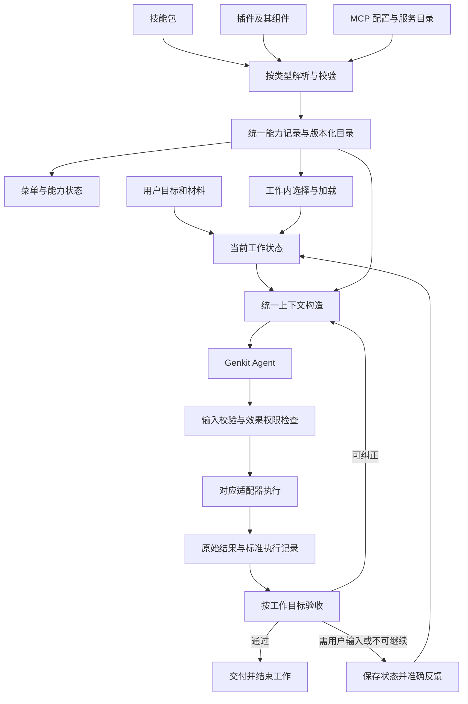

# 小七统一能力契约与工作生命周期规格

日期：2026-11-04。依据源码：`475663fb16c39a973b92fb79a97f8301a6b3c311`。

状态：实施主线（2026-11-04）。用户已确认统一契约方向、当前工作内持续使用、发送后移除标签、停止即暂停、运行中补充、完成后修改、版本生效以及同一问题最多五次尝试。代码已按本文顺序开始修改；当前检查与发布状态见第 12 节。本文定义行为和验收，不替代 UI 视觉稿。

前置证据：[Agent 架构诊断](C:/Users/20833/Desktop/xiaoqi_app/docs/diagnostics/2026-11-04-agent-architecture-audit.md)。

用通俗的话说，这次要补齐六件事：

1. **大家认同一本能力名册**：菜单显示的、模型读到的、工具实际执行的，必须指向同一个能力与版本。
2. **记住正在做的工作**：目标、文件、待答问题和能力选择放进工作记录，不能靠输入框重复贴标签维持。
3. **分清“看说明”和“动手做”**：读过技能不等于启动完整流程，附了文件也不等于授权生成或发布。
4. **把文件和上下文接通**：模型能按稳定引用继续读取资料，换一轮或换沙箱后仍能找回。
5. **每一步留下真实凭据**：选择、加载、执行、验收分别记账；断线后先查原结果，不能盲目再做一次。
6. **按用户目标判断完成**：回答了一句话、执行了工具、生成了文件，都不单独代表整项工作结束。

现成组件继续负责 Genkit 执行、技能加载、MCP 协议、schema 校验和追踪；小七补的是这些组件之间的产品规则与连接。下面的字段名、阶段划分和未确认交互均为方案建议，不是已经实现的功能。

## 1. 产品目标与本次范围

服务对象：在小七聊天中选择技能、插件或 MCP，连续提交要求、补交材料、回答追问并取得成果的用户。

核心问题：界面选择、服务端真实能力、模型上下文、工具执行和完成判断之间不一致，导致虚假就绪、重复询问、文件被介绍分支忽略、资源不可读或验收错配。

成功标准：用户能完成“选择能力 → 了解用法 → 提供材料/目标 → 执行 → 验证 → 交付/继续/取消”的完整闭环；每个状态和成功声明均有实际依据。

本版本优先覆盖 book-to-skill 的说明、分析、完整转换三种使用场景，再用插件组合和 MCP 场景验证同一契约。技能、插件、MCP 使用相同公共规则，协议特有能力仍由各自适配器保留。

后置：更换主 Agent 框架、跨聊天长期记忆、向量库、模型训练、自动公开发布、额外的多 Agent 管理平台。当前权限、取消、已有数据、分支隔离和恢复保障必须保留。

## 2. 已确认的产品决策

### D01：能力选择在当前工作内持续

用户于本轮明确选择：**“当前工作结束为止：补文件、回答追问和继续操作都沿用；换工作后结束。”**

该选择是使用偏好，不代表每轮强制执行，也不代表新增授权。

- 补材料、回答待答问题、修正当前成果、继续未完成步骤，沿用当前工作的能力绑定。
- 工作经验证完成、用户明确表示放弃（不包括普通点击停止），或用户明确转向另一项工作后，不向新工作自动复制该偏好。
- 查看已完成结果仍可引用历史成果与来源，但不自动重跑原工作。
- 结束工作不卸载技能、不删除历史、不取消账号级 MCP 配置；只结束这份工作的选择和按原作用域到期的临时授权。
- 等待材料、等待确认、暂停、可恢复阻塞，不等于工作结束。
- 仅选择能力、问用法、等待用户补充目标或材料，属于准备阶段；这时的一次介绍回复不应把能力选择提前结束。用户明确只要一段介绍时，才按该说明目标判断完成。

### D02：统一契约的边界

采用同一套身份、版本、可用性、选择、加载、执行和验证规则。每个具体工具仍有自己的输入/输出结构；不同协议不必使用完全相同的原始文件格式。

菜单、模型工具定义与执行校验从同一份已解析能力记录派生。前端输入元数据、显示名称、模型猜测或技能正文都不能成为权限与就绪状态的权威来源。

### D03：此阶段先定链路，再实现

交互与执行顺序已确认：确认交互 → 修入口与工作状态 → 补执行、上下文与验收闭环 → 验证技能/插件/MCP → 发布与真机验收。实现沿用现有页面，不新增能力常驻展示或“结束工作”按钮；尚未讨论的新视觉/行为变化仍需按 Product Design 流程处理。

### D04：发送后移除标签，不增加能力状态展示

用户明确要求：标签随消息发送，供 Agent 理解本次意图；发送后直接从输入框移除，不再显示“当前工作使用的能力”。选择事件和工作内绑定由服务端保留，不因输入框标签消失而清空，也不靠下一轮回填标签来继承。沿用既有发送成功/失败与草稿恢复机制，不能丢失尚未成功提交的选择。

### D05：停止按钮只暂停当前任务工作

点击现有停止按钮，停止当前工作的自动执行，保留目标、材料、能力绑定、已完成成果与执行记录；等待用户继续或给出新要求。不新增“结束工作”按钮或菜单项。用户用自然语言明确放弃/换工作，或目标经验证完成时，仍可按 D01 结束相应工作绑定；这些是后台语义，不要求额外按钮。

暂停后不因后台唤醒、重连、模型重试或 Stop hook 自动恢复执行。已发出的操作按实际结果记录，未知结果先核对，不能假称暂停撤销了全部效果。

### D06：执行中发送补充，按当前工作纠正或转向

用户确认运行中发送的补充默认进入当前工作，在安全执行边界处理；改变目标后阻止不再适用的旧操作，已发出的外部操作先核对。明确提出另一项工作时按新目标处理。不把“等待本次全部结束后再处理”的普通排队作为默认策略；无法安全接纳时保留输入并说明状态，不静默丢失。

### D07：完成后的修改与能力升级

用户确认：在原聊天里引用已完成成果修改时，后台建立关联的新工作，重新核对能力与权限，不从头重跑旧流程。普通升级时，本工作继续绑定仍合法且可取得的旧版本，新工作使用新版；用户主动切换时重新核对，禁用/撤销立即阻止后续相关调用。

### D08：同一问题含首次最多五次尝试

用户已明确选择：**“同一问题最多尝试 5 次，含首次；正常成功的其他工具调用不受此限。”**第 5 次仍未解决，停止当前工作的自动执行，用几句大白话说明情况与已知原因，保留进展并等待用户指示，不进行第 6 次自动尝试。不是整项工作总共只能调用五次工具。

五次以内允许 Agent 根据失败证据自行诊断、调整方法和纠正，用户已允许为排错联网搜索相关方案。该规则同时进入系统提示词与运行时计数/阻断；具体计数与恢复见第 8.4 节。

## 3. 统一链路与职责

职责分配：

| 层 | 负责 | 不负责 |
|---|---|---|
| Flutter 展示与草稿 | 表达用户选择、文字、附件、操作；展示服务端状态 | 自行判定技能可执行、创建运行权限、用标签反复发送冒充继承 |
| 类型适配器 | 读取来源、展开插件组件、解析真实 schema/资源、协议执行 | 自行扩大用户目标、越过效果权限 |
| 能力解析与目录 | 校验账号与版本、生成同源描述和工具目录、标记失效原因 | 仅凭名称认定能力存在 |
| 工作协调与上下文构造 | 保留目标、材料、选择、待答事项；识别本轮与当前工作的关系 | 把所有历史正文当作持续有效的指令或授权 |
| Genkit 执行层 | 决定下一步，调用提供的工具，处理观察结果 | 宣称自己已获得程序尚未授予的权限 |
| 效果权限与执行记录 | 校验输入、授权、撤销、预算；追踪执行及未知结果 | 由模型计划直接决定权限 |
| 成果验证 | 对照工作要求检查证据，给出具体失败项 | 只因模型说“完成”或某工具成功就结束工作 |

这些是逻辑职责，可以由现有模块逐步承担；不要求建立七个服务、七个数据库或七个 Agent。

## 4. 公共契约：信息只维护一个权威来源

以下是逻辑字段与语义，尽量映射到已有 ID、存储和事件，不重复建一套系统。本轮已把工作生命周期所需字段映射到现有请求/会话机制，包括 `work_id`、`work_goal`、`work_context_message_ids`、`work_reference_question_id`、`problem_attempt_stage_id` 与 `keep_work_open`，并同步 API 合同版本 31；其他逻辑字段不因此自动成为新的公开 API。

### 4.1 能力定义与当前可用性分离

| 信息组 | 必须包含的语义 | 约束 |
|---|---|---|
| 身份 | 能力 ID、组件 ID、类型、所属安装/连接 | ID 由宿主绑定账号；名称不能替代身份 |
| 来源与版本 | 来源、安装版本/目录修订、内容或定义指纹 | 技能包绑定不可变版本；MCP 记录实际观察到的目录与配置修订 |
| 功能描述 | 名称、用途、适用条件、不支持的操作 | UI 和模型使用同源描述，可按展示场景裁剪，不改能力事实 |
| 工具定义 | 工具 ID、说明、输入 schema、可选输出 schema、效果类型 | 定义与执行器校验同源；无输出 schema 时标为未声明，不虚构 |
| 资源与脚本 | 包内资源清单、资源引用、脚本入口、执行要求 | 仅可读取绑定版本中实际存在且允许的内容 |
| 宿主需求 | 运行环境、依赖、连接/身份条件、支持情况 | 配置存在不等于环境满足；限制必须可解释 |
| 协议扩展 | MCP 元数据、App 可见性、插件组件关系等 | 保留必要原始字段，不为统一外壳而丢失协议语义 |
| 可用性观察 | 针对说明/读取/执行操作的检查结果、时间、修订、失败原因 | “可说明但暂不可执行”可以成立；不得统一假报 ready |

能力定义尽可能不可变；可用性是会过期、可被撤销的观察。每次真正执行仍检查账号、版本、权限及所需资源。

MCP 远端目录是动态的，不冒称其像本地不可变技能包一样可永久锁定。沿用当前目录刷新与失效机制；工具定义变化后使旧绑定失效并重新核对，不能继续用旧 schema 静默调用。远端没有提供原子修订保证时，如实记录本地核对的目录修订和返回验证结果。

配置中的密钥仅保存为受控秘密引用，不进入模型、公开能力定义、聊天历史或普通日志。

### 4.2 工作内绑定

一份工作记录选择了哪些能力、具体版本/目录修订、选择来源、选择与撤回事件。加载记录进一步区分 `reference`（获取说明/知识）和 `execution`（执行工作流）。

- 用户显式选择、用户确认的替换与当前工作继承必须可区分。
- 自动发现的适用能力可以被按需读取，不因此变成下一项工作的用户偏好。
- 包内提示、工具返回和模型建议不能修改用户选择的来源记录。
- 用户换工作后按新工作解析，不把上一工作的排除集合或完成要求无条件传播过去。
- 对当前工作明确移除的能力，不允许自动发现立即把它重新激活；如确实需要它，先准确说明影响。

### 4.3 工具接口同源

每个工具定义只维护一份权威 schema 和说明，生成模型可见定义，并由运行层验证实际输入。适配不同模型的 schema 能力时必须保留等价约束；不能支持的语义要明确处理，不能悄悄删掉关键校验。

宿主注入租户、工作、执行身份及权限绑定。模型只提供工具所需业务参数，不能自填账号、越权对象或批准状态。

沿用现有清楚的工具名称，不为统一而一次性改成一个无边界的 `execute_anything`。既有 MCP 大目录搜索/调用入口继续按真实工具 schema 二次校验。

### 4.4 结果记录与协议载荷分离

通用执行记录包含：调用 ID、能力版本/目录修订、实际工具、输入摘要/指纹、执行阶段、效果类型、状态、可追溯结果引用、错误类别和恢复建议。记录成功调用不等于工作完成。

模型可见结果在受控预算内给出必要数据及可取回引用。MCP 的 `content`、`structuredContent`、错误语义、资源链接、App 元数据按协议保留；大结果落盘后保留完整引用，不能只有“已保存”却无法找回。原始协议载荷与小七的执行状态可以并存，不强行把所有返回都压成同一种业务 JSON。

### 4.5 配置放在哪里、何时生效

“统一配置”是统一归属、校验和生效规则，不是把所有内容塞进一个配置文件。分成以下四层：

| 层级 | 保存什么 | 不应混入什么 |
|---|---|---|
| 能力包/协议定义 | 名称、描述、组件、工具 schema、资源与执行要求 | 账号凭据、本次工作授权 |
| 账号安装/连接 | 启用状态、来源版本、连接身份、允许的宿主配置、秘密引用 | 聊天目标、临时草稿、模型生成的批准 |
| 当前工作 | 选择的能力、绑定版本、材料、目标、待答事项、完成条件 | 明文密钥、长期账号配置的副本 |
| 当前执行与操作 | 尝试身份、实际参数、适用授权、预算、收据及结果状态 | 擅自改变包定义或用户目标 |

| 发生的变化 | 生效规则 |
|---|---|
| 新安装或普通升级 | 重新校验并刷新目录；新工作使用新目录。进行中的工作不能被静默替换版本 |
| 当前绑定版本仍合法且可取得 | 本工作继续原版本；用户主动切换时重新核对已读内容、工具、授权及验收基准，按 D07 执行 |
| 版本被删除、禁用、撤销或判为不支持 | 后续依赖该能力的操作受阻；不偷偷改用同名能力 |
| MCP 工具 schema、连接身份或效果范围变化 | 下一次调用前重新解析，旧目录/加载记录及不再适用的批准失效；不能沿用旧参数直接调用 |
| 密钥轮换 | 重新解析受控秘密引用；若账号身份或权限也变化，额外重新核对相应作用域 |
| 暂时断连 | 保存用户选择，标明当前不可执行；恢复后重新检查，不把选择本身删除 |
| 用户移除选择、拒绝或撤销授权 | 在接受该事件后阻止受影响的新调用；已经发出的操作保留结果并按需核对 |

名称用于展示，身份按安装/连接及组件命名空间解析。两个插件均提供同名工具时不能相互覆盖；模型可见别名必须能唯一回到原身份。缓存键包含相应账号、版本/目录修订、宿主条件与授权修订，不能跨账号复用可用性结论。

### 4.6 共用加载阶段，保留各类型的加载对象

统一顺序为：**发现 → 解析身份 → 校验来源与定义 → 按需读取 → 核对执行前提 → 提供给模型/执行器 → 记录证据**。

| 类型 | 先发现什么 | 按需读取什么 | 真正执行什么 |
|---|---|---|---|
| 技能 | 真实版本的摘要与资源索引 | `SKILL.md` 正文、引用文档、脚本说明 | 已有工具/脚本按技能方法完成目标；读取 Markdown 本身不是执行器 |
| 插件 | 包及其 skills、commands、hooks、agents 等组件 | 本次请求涉及的组件定义、依赖和作用域 | 对应组件的既有运行机制；不能把“选中插件”解释为执行所有组件 |
| MCP | 连接能力及其实际提供的工具/资源/提示目录 | 真实工具 schema、选定资源或提示内容 | 对应协议操作；服务未提供的目录不伪造，提示内容不是权限凭据 |

插件钩子继续依照其原有事件和授权机制触发；统一选择不能额外触发钩子或放宽其权限。MCP Apps 的 UI 资源和可见性元数据保留，不能把 App 的展示成功当作业务调用成功。

每次加载返回可核对的身份、版本、资源范围和错误原因。只读摘要时记录为“已读摘要”，不声称读完全文；资源分页记录实际覆盖范围。适配器无法保留关键语义的组件应明确报告限制，不能包装成完整支持。

### 4.7 客户端与服务端最小交接内容

以下是待冻结的契约语义，不新增第二套公共 API，也不要求使用这些字段名：

| 交接 | 必须表达的信息 | 唯一权威 |
|---|---|---|
| 客户端提交 | 稳定请求 ID、消息/分支位置、已知工作修订、文字和材料引用、用户本次选择/移除/替换动作 | 客户端表达用户输入；不声明已加载、已授权 |
| 服务端接受 | 接受或拒绝的原因、消息归属的工作及修订、已解析能力身份、当前状态与下一步 | 服务端核对后落库；前端用回执更新状态 |
| 运行事件 | 可去重的事件 ID、工作/尝试/操作关联、状态变更、结果引用 | 真实执行与验证模块 |
| 客户端重连 | 最近确认的事件位置或状态修订 | 从已有事件/任务查询机制补齐，不能用本地标签重建服务端事实 |

未改变能力选择的下一轮，不再伪造一次“用户显式选择”。服务端依照工作状态解析继承；明确移除与普通空草稿必须能区分。

## 5. 不再使用一个总状态代表所有事情

状态应分成相互关联但独立的几个维度；下列名称为逻辑名称：

| 维度 | 例子 | 更新依据 |
|---|---|---|
| 能力可用性 | 未核对、核对中、就绪、受阻、已过期、不支持 | 真实安装/目录/环境检查；未知值不得默认就绪 |
| 工作内选择 | 未选、显式选择、继承选择、已移除、工作结束 | 用户操作、已确认的工作持续规则 |
| 知识加载 | 未读、已读摘要、已读正文/资源、读取失败 | 对应版本与资源的实际读取记录 |
| 操作许可 | 无需额外批准、待批准、适用批准、拒绝、撤销、已过期 | 宿主策略及当前操作的授权记录；不是对整项能力一概批准 |
| 执行 | 排队、执行中、等待输入、等待授权、暂停、核对未知结果、成功、失败、取消 | 执行与恢复事件 |
| 验证 | 未检查、不适用、通过、未通过、需要人工判断 | 具体任务验收器与证据 |

两个重点：

1. “已选择”“已读说明”不能推出“正在执行”；“调用成功”不能推出“工作已完成”。
2. 插件可以部分可用：明确列出哪些组件可用、哪些受阻。当前工作明确依赖的组件受阻时不能静默跳过后宣称整体完成。

当前客户端 `_mcpState` 对未知值默认返回 ready，见 [现有解析](C:/Users/20833/Desktop/xiaoqi_app/lib/features/capabilities/data/capability_models.dart:121)。统一状态契约应覆盖未知/缺失状态处理，不能把此类默认值沿用为就绪证据。

## 6. 当前工作的状态与跨轮处理

### 6.1 工作和执行尝试分开

聊天可以包含多项工作；同一工作可以跨多轮用户消息、多个执行尝试和多个快照。复用已有 `workflow_id`、`task_id`、消息和快照关系时，应先明确各自含义：当前 `workflow_id` 来自 conversationId，不能未经评审就假定“一个聊天永久等于一项工作”。

需要的最小工作信息：

- 目标和模式：了解用法、分析、生成、修改、外部操作等。
- 用户已确认的约束及其来源消息。
- 能力绑定、材料/产物引用与版本。
- 待答问题、已收到的答案、下一步及已完成步骤。
- 可验证的完成条件、实际证据和未完成原因。
- 工作状态、修订及与执行尝试的关联。

优先复用当前 Genkit session 和存储；记录采用结构化状态并保留事件来源。模型可以提议更新目标/下一步，用户决策和真实执行证据才是相应字段的依据。

### 6.2 对后续输入的处理

| 用户输入 | 应有行为 |
|---|---|
| “这个技能怎么用” | 按需读真实说明；不启动完整转换，也不强制文件交付 |
| 对待答问题作答 | 写回原问题和工作，不重新询问同一问题 |
| 补交书籍或其他材料 | 绑定当前工作，按既有目标继续；缺目标时只补问缺失项 |
| “继续” | 接续明确未完成工作；若原执行结果未知，先核对原结果 |
| “改成只分析，不生成技能包” | 更新当前目标并撤回已不适用的交付要求；不从旧计划恢复已撤回操作 |
| 明确提出另一项工作 | 结束旧工作的自动选择继承，为新工作重新解析能力；保留旧历史与成果 |
| 询问已完成成果 | 引用已验证成果回答，不自动重跑原工作 |
| 模糊指代且有多个候选 | 只有会影响对象或操作时才澄清，不要求用户反复重述已知信息 |

只发送技能标签属于能力选择/了解阶段，不等于已经要求整本转换。标签与材料同时发送不能走“无材料的纯介绍”捷径。

### 6.3 停止即暂停，工作结束由目标和用户意图决定

技术规则：停止接受后禁止继续发起相应新操作；已发出的调用可能处于结果未知，必须先对账，不能伪称已撤销远端效果。已完成产物保留。

按 D05，点击停止只暂停当前任务工作，不增加“结束工作”按钮。后台仍区分暂停、完成和明确放弃；普通停止不结束能力绑定。恢复由用户继续或新要求触发，不能因旧的自动执行授权而自行恢复。

运行中换工作，应先处理旧执行的停止/核对状态，避免旧结果混入新工作；是否提供并行工作不在本次默认范围内。

### 6.4 什么才算“当前工作结束”

工作分为准备、进行、等待、待核对、验证和终态；这与单次模型回复是否结束分开。准备阶段可以只有能力选择，尚无完整目标，不应为凑齐字段而虚构任务。

判定完成须同时满足：当前目标足够明确；本目标要求的步骤和成果有对应证据；验证对当前修订有效；没有必需的待答问题、未完成步骤或结果未知的效果调用。通过后可以完成，不额外要求每个问答都让用户点一次批准。可选建议或“还可以继续优化”不应永远阻止完成。

| 边界场景 | 方案行为 | 决策性质 |
|---|---|---|
| 选技能 → 问用法 → 等上传文件 | 保持准备状态和选择；问用法的回复只完成一个步骤 | 对 D01 的链路落实 |
| 明确只分析，不转换 | 分析通过对应验收即可完成；不得为技能的全部流程补做 ZIP | 遵循用户目标 |
| 完成前修改要求或补材料 | 更新同一工作的目标/材料修订；保留已完成事实，重新计算受影响验收 | 技术必需 |
| 完成后明确要求修改旧成果 | 在原聊天建立关联原成果的新工作；重新解析所需能力，不复活旧执行或批准，也不能借新工作清除未解决问题的尝试记录。明确要求沿用的能力可重新绑定 | 已确认 D07 |
| 工作已完成，只发送“继续” | 有明确指向的新步骤则建立对应工作；没有可接续步骤才询问缺失目标，不自动重放旧操作 | 防重复执行的必要规则 |
| 新目标能否算同一工作不明确 | 模型提出归属判断；会改变操作对象、选择范围或完成条件时澄清一次 | 产品语义与技术保护共同约束 |

“同一工作”以用户目标的连续性判断，不以换模型、隔了多久、是否有新附件或是否产生新 task ID 单独判断。工作判为结束后，保留原因和对应证据，不能仅凭最后一条 assistant 消息结束。

### 6.5 重复发送、并发、分支和恢复

这些规则复用已有存储修订、执行锁和操作日志；不要求新建队列服务：

- **重复提交**：网络重发使用同一个请求身份；服务端返回原接受结果，不再创建一份工作或重复效果调用。两次有意发送相同文字仍是两个不同用户消息，不能仅按文字去重。
- **唯一写入顺序**：同一工作同一时刻只允许一个执行者提交权威状态。用户改目标、移除能力或取消后增加修订；旧执行的迟到结果可以存为历史事实，不能覆盖新目标或宣告新要求已完成。
- **运行中再次发送**：按 D06 默认作为当前工作的补充/纠正，在安全边界接纳；明确另一目标时建立新工作。复用现有转向机制，尚不能安全接纳时保存输入并说明状态，不静默排到整个旧工作完成以后。
- **分支**：只从选定祖先快照构造独立状态。可以引用共有的历史材料与已完成成果，不能复制执行锁、运行中的调用或待批准凭据；外部已发生的效果不会因切分支而倒退。
- **分支的未决效果**：保留对原操作身份、已发生效果和未知结果的只读关联，不复制执行权或批准。分支继续同一逻辑操作前仍先查原记录，不能靠换分支或换尝试 ID 绕过对账与防重复执行保护。
- **重启/换模型**：重新取得服务端状态和适用能力，重建上下文视图；不重新执行已完成操作。模型不支持某种 schema 或媒介时明确适配限制，不能因切模型改变事实或放宽校验。
- **跨执行重试**：新的运行尝试拥有新的尝试身份；同一个逻辑效果操作在允许重试时沿用其幂等/对账关联。没有幂等保证且结果未知时，保持待核对并说明限制。

工作身份负责“在做什么”，用户回合负责“这次说了什么”，执行尝试负责“这次运行到哪里”，效果操作身份负责“这件外部动作有没有做过”。不能用一个 task ID 同时承担全部含义。

### 6.6 Genkit 的停止、interrupt 与恢复如何接入

2026-11-04 核查官方文档和项目锁定的 Genkit Dart 1.0.0 源码后，区分以下机制：

| 机制 | 框架实际含义 | 小七的使用方式 |
|---|---|---|
| 前台 `AgentTurn.abort()` / cancellation token | 取消当前附着回合；服务端会话可保存可重新驱动的安全快照 | 作为用户停止链路的一部分，不把取消接收输出当作远端已停止的证明 |
| 工具 `interrupt` | 工具主动等待外部回答、批准或输入 | 对应待答/待授权；与用户主动点击停止分开 |
| `chat.resume(respond/restart)` | 回答匹配的待处理工具请求；respond 提供输出，restart 重新执行原工具 | 只能处理真正的工具中断，普通“继续”不能伪造工具批准 |
| 从 snapshot 建 chat 后再次 send | 从保存状态重新驱动或带新要求继续 | 用于停止/失败后的接续，不保证从任意 token 或脚本语句原地继续 |
| detached 后台任务 abort | 通过持久化快照处理后台终止，经历停止处理中到终态 | 只用于对应后台运行方式，不能替换附着执行的取消控制器 |

官方依据：[前台取消与失败后恢复](https://genkit.dev/docs/dart/agents/run/)、[工具中断与 resume](https://genkit.dev/docs/dart/agents/interrupts/)、[后台取消与快照状态](https://genkit.dev/docs/dart/agents/background/)。这些是框架机制；“暂停当前工作并保留意图”由小七映射，框架不会要求产品增加“结束工作”按钮。快照 completed、普通模型 stop、工具 interrupted 都不能单独决定用户工作已完成。

当前项目已经在 [停止处理](C:/Users/20833/Desktop/xiaoqi_app/lib/pages/home_page.dart:5642) 中同时取消本地流和发送任务取消请求，在 [服务端运行入口](C:/Users/20833/Desktop/xiaoqi_app/xiaoqi_harness/genkit_server/lib/src/api.dart:1005) 中注册执行取消控制器；[客户端恢复](C:/Users/20833/Desktop/xiaoqi_app/lib/pages/home_page.dart:3563) 使用原 task 与 snapshot。继续复用这条路径，不另外建设一套暂停系统，也不盲目改走旧 resume 接口。

这次追加检查发现两处需要修正或动态核验的映射：

1. [取消入口](C:/Users/20833/Desktop/xiaoqi_app/xiaoqi_harness/genkit_server/lib/src/api.dart:2707) 可将任务落为 pausing，却立即广播 cancelled；应统一成“请求已接受 → 正在收尾 → 已暂停/待核对”的真实状态，不能提前假报远端完全停止。
2. 小七执行取消 token 与外层 SDK token 分开；[SDK 1.0.0](C:/Users/20833/AppData/Local/Pub/Cache/hosted/pub.dev/genkit-1.0.0/lib/src/ai/agents/agent.dart:581) 会把外层 token 未取消时返回的 aborted 归为失败。需对照任务、事件和快照验证两层传播，保留停止原因，不能直接把 SDK failed 解释成用户工作失败或完成。该项是源码支持的风险，未声称已动态复现。

保留明确停止原因，例如用户暂停、问题尝试耗尽、拒绝/撤销、系统故障或目标完成。所有原因都可停止某次执行，但是否允许自动继续、是否等待用户、是否结束能力绑定各不相同。

对照产品：Codex 官方协议区分 `turn/interrupt`（中断当前回合）、`thread/resume`（恢复会话）和 `turn/steer`（给运行中的回合补充输入）；Claude Code 官方交互文档说明 Ctrl+C 可中断正在执行的操作。可借鉴“停当前执行、保留会话继续”的使用方式，不能据此推断两者所有版本的按钮或后台子任务策略完全一致。[Codex App Server](https://developers.openai.com/codex/app-server/)、[Claude Code 交互说明](https://code.claude.com/docs/en/interactive-mode)。

## 7. 统一上下文构造与资源链路

每个需要决定下一步的环节，都获得同一修订下的必要工作信息，而不是分别从聊天文字猜测：

1. 稳定系统规则和当前效果权限说明。
2. 当前工作目标、约束、状态、待答事项与用户最新输入。
3. 已校验的能力摘要和版本/目录修订。
4. 按需加载的技能说明、资源和材料证据。
5. 必要的近期消息、已完成动作及未完成验收项。

保留完整原始轨迹，上下文是可重建的推理视图。路由不必得到整本书或全部工具历史，但必须得到用户刚刚在回答哪个问题、补哪份材料，以及该工作已确认的目标。

用户上传的书籍、网页、文件和工具返回属于待处理资料，其中的提示文字不能作为新的用户指令或修改权限。已校验技能正文提供方法和流程，但仍服从用户当前目标与宿主约束；必须在上下文中保留指令来源与资料来源的区别。

资源用稳定引用寻址，再映射到本次沙箱路径。读取由账号/版本绑定的清单控制；支持合法 `chapters/` 等实际资源，保留路径规范化、文件类型/体积、越界和链接校验。文本资源支持分段/游标，返回覆盖范围与下一段引用。

隔离容器仍可按调用重建；稳定性来自工作资源映射，不来自要求模型记住旧临时路径。依赖准备复用已有任务依赖机制，依赖下载授权与脚本业务联网授权分别检查。

上下文预算按输入、输出预留、工具结果与必要状态分配；优先减少大结果和重复资料，再做结构化摘要。保留工具调用/返回配对、用户约束、授权/撤销、待办与证据引用。过期技能正文不直接承继为新工作指令；持续工作需要的已读证据应能重新取回。

同一份工作视图可给不同环节提供裁剪后的内容：路由读取目标、待答问题和材料概况；执行读取相关技能/工具与证据；验证读取完成条件及实际成果。三者须带相同工作修订，不能分别形成互相冲突的目标。

摘要属于派生信息，保留来源消息/资源引用与生成修订；发现与原证据冲突时回读来源。工作状态、用户明确约束和当前授权由程序保留，不交给摘要模型自行决定删除。预算仍不足时分段读取或明确缩小本次处理量，不截掉关键条件后继续宣称完整执行。

## 8. 权限、恢复与验证

### 8.1 权限继承边界

能力选择可以按 D01 继承。权限继续按原授权对象、动作、参数、域名、有效期与撤销修订核验，不因“同一工作”扩大范围；不重复索取仍有效且适用的授权，也不把旧批准泛化为新动作批准。

每次效果调用前检查当前权限、选择撤回、版本/目录是否仍有效。工具描述中的“只读”等注解是元数据，不能替代宿主策略。外部内容不能改写工作目标或权限。

提交效果调用时，还要在受控检查/领取路径中核对当前工作修订，以及该操作是否仍适用于当前目标。用户改为“只分析”后，旧执行不能继续提交转换、安装或发布，即使先前某项批准尚未到期；已经发出的操作如实核对，不假称已被追回。

### 8.2 错误与纠正策略

| 错误类型 | 处理 |
|---|---|
| 参数不符合真实 schema | 返回字段级问题，允许在预算内修正 |
| 未安装/版本或资源不可用 | 返回具体能力与原因，重新解析或请求必要用户操作；不冒称已加载 |
| 权限撤销/拒绝 | 停止相关动作；不换入口绕过 |
| 依赖缺失 | 沿用现有受控依赖准备；不支持的系统要求明确说明 |
| 暂时网络/服务故障 | 仅在可安全重试条件成立时有限重试 |
| 执行结果未知 | 按原调用/执行身份核对；未证明未执行前不自动重放副作用 |
| 成果不合格 | 返回具体未通过项、证据和允许的修正方向 |

次数、时间和成本预算持续生效；不以递归重建任务重置预算。错误恢复不能改变原用户授权或降低已确认的完成标准。

### 8.3 按目标验收

说明问答检查依据与准确性；分析检查来源、覆盖和问题回答；技能转换检查成果结构、引用、章节覆盖、来源、扫描与最终包一致性；外部操作检查真实收据和最终状态。

模型可以提出执行计划，但不能单独决定最低完成标准。纯说明/分析不强制 ZIP；生成任务不以一句“已完成”代替文件。每个验证结果绑定工作修订、对应输入、操作/产物版本，避免旧证据用于新要求。

验证至少区分两层：程序检查文件可取回、结构、来源引用、schema、最终包指纹与扫描一致性；模型或领域检查器评估内容是否回答问题、是否有依据。第二层的判断应说明证据与不确定性，不能冒充程序证明。缺页、解析失败或仅覆盖部分材料时，应明确覆盖范围和未完成原因。

用户要求完整转换时，章节覆盖按原书目录/结构与实际提取结果核对，不用提取器的粗略章数直接做成功标准。分析任务则按已确认范围验收，不能无故扩大为全书逐页处理。修正后的最终文件须重新通过受影响的检查，旧扫描或旧引用检查不能直接套用。

### 8.4 同一问题的五次尝试与停止规则

该上限针对同一个未解决问题，第一次执行或验证失败已占第 1 次，最多再有 4 次尝试。正常成功的其他工具调用不占该问题的额度，也不能把已累计次数清零。不得通过换工具、改参数、换模型、分支、新建 task 或子代理来把同一问题伪装成新问题。

实施时在现有工作/执行日志中保存问题身份、受阻目标/对象、尝试序号、操作关联、失败证据、已采用方法、结果及等待状态；运行层管理计数，模型只能提交诊断和修复建议。问题归并依据受阻步骤、对象及错误关联，不只按错误文案匹配，也不允许模型随意重新命名归零。

| 情形 | 计数与行为 |
|---|---|
| 首次受阻调用或成果验证失败 | 建立问题记录并记第 1 次；先读错误证据，决定是否存在可修复路径 |
| 更正参数、替换方法后重新执行/验证同一受阻步骤 | 每次实际尝试占一个剩余额度；第五次成功则结束该问题，第五次仍失败则停止等待 |
| 成功读取日志、搜索资料或检查环境 | 属于诊断，不能凭此把原问题标成解决或清零；仍受总时间、工具与成本预算约束 |
| 诊断工具自身反复失败 | 不能无限排查；为实际诊断故障记录问题并受同样上限约束，保留与原问题的关联 |
| 同一问题被多个并行调用/子代理处理 | 共用同一额度，先领取再执行；不能各自获得五次。达到上限后禁止新调度，已发出的调用按实况收尾 |
| SDK/HTTP/执行器内置自动重试 | 对同一失败操作不能再叠加一套五次额度；接入时限制或统一计数。效果未知不进入盲目重试 |
| 权限拒绝/撤销、明显不可恢复条件、用户主动停止 | 立即停止相应操作，不要求凑满五次 |
| 第五次仍未解决 | 退出当前自动执行循环，记为受阻并等待用户；不标完成、不清空材料和工作选择、不自动开启新一轮 |
| 用户之后明确要求继续排查或提供新条件 | 保留原问题及五次记录，记录用户的新指示，才可启动新的受控尝试阶段；每阶段仍最多五次，并保留未决效果和既有总预算 |

普通说明回复、重新打开客户端或后台定时唤醒，不构成继续失败修复的指示。联网搜索使用可用工具和现有网络策略；用户已允许为排错搜索，无需仅为这类搜索重复询问。联网诊断不自动授权安装新依赖、提交外部写操作或扩展原任务目标。

提示词要求：先核对失败原因与已有证据，有新依据再改变方法；允许在边界内自主排查和搜索，禁止无变化地机械重试；达到上限用简短中文说明“卡在哪里、已知原因/未知处、保留了什么、需要用户决定什么”。运行层即使遇到模型继续请求，也阻断第六次尝试，并从已有记录生成或限量生成最终说明，不继续发工具调用。

示例文案（非本轮真实故障）：“已尝试 5 次，这份文件仍无法解析。目前只能确认解析器持续报错，还不能确定是文件损坏还是格式不支持。材料已保留，我先停在这里，等你决定换文件或继续排查。”

Genkit 的 `maxTurns` 和现有总工具/时间/成本预算继续作为外层保护，不能用 `maxTurns: 5` 冒充“同一问题最多五次”：一次模型回合可以涉及多个工具，成功调用也不等于本问题已解决。该问题级计数需要小七结合实际工作和错误日志实现。

## 9. UI 交互确认清单

已确认：当前工作内持续选择；标签发送后从输入框移除，不回填，不新增“当前工作使用的能力”状态栏、卡片或胶囊。选择意图随消息提交，后台保留工作绑定。停止沿用现有按钮，语义为暂停当前工作，不增加“结束工作”入口。

用户可通过现有能力菜单提交新的显式选择，或用自然语言表达替换/不再使用某能力；清空普通草稿不等于撤销已发送的工作选择。运行中补充、完成后修改和版本变化按 D06/D07 执行。失败达到五次后用简短对话反馈并等待用户，不新增复杂的错误处理面板。

设计阶段基于现有技能菜单、输入标签和对话页面，覆盖：选择/替换/移除、只有标签、标签＋材料、补材料、无安装、部分可用、授权等待、执行暂停、取消、结果未知、失败恢复、完成及新工作。

现有视觉来源与组件应复用，不能把旧状态文档中已过时的实现说明当作当前事实。参见 [原技能 UI 状态规格](C:/Users/20833/Desktop/xiaoqi_app/docs/design/skills-plugins-v1-state-spec.md)。

全局交互约束同步适用：

- 空输入框收起软键盘时退出焦点；后续布局不能抢焦点。
- 点击按钮/空白退出当前输入焦点并保留文字，按钮当次点击正常执行；切换到另一输入框正常转移焦点。
- 有文字时仅收起键盘不强制失焦；选择技能不自动弹键盘。
- 页面进入不使用转圈加载态，采用静态占位；任务按钮内进度反馈按现有例外处理。
- 已冻结且能忠实矢量表达的固定视觉资产，先交付独立 SVG、预览和清单，再接入。

## 10. 复用与实现顺序

研究沿用本次 [审计中的官方来源与许可证清单](C:/Users/20833/Desktop/xiaoqi_app/docs/diagnostics/2026-11-04-agent-architecture-audit.md)。结论不变：

| 能力 | 使用方式 |
|---|---|
| Genkit Agent、Session、interrupt/resume | 继续使用现有基础；补工作状态和一致的输入 |
| Schemantic 与 Genkit Tool 定义 | 复用同源 schema 和运行校验，不手写第二份模型参数说明 |
| skills middleware、genkit_mcp | 继续承担对应发现/加载/协议调用；宿主适配边界由统一契约约束 |
| 已有版本绑定、MCP 目录失效、授权、沙箱、恢复日志、任务依赖 | 保留并整合，不重复建设 |
| Genkit traces、Evaluation、genkit_otel | 用于关联轨迹、指标与场景评测；默认不采集秘密和原始正文 |
| JS contextCompression | 作为官方参考，按需移植策略；不当作可直接导入的 Dart 组件 |
| Agent Skills skills-ref | 仅作规范和离线参考；上游演示库不直接作为生产执行引擎 |

实施次序：

1. 完成本规格的产品语义评审与现有 UI 交互设计确认。
2. 冻结最小字段、各状态转换、来源/权限边界及测试场景；评审既有数据迁移方案。
3. 实现能力解析与同源目录，修纯介绍捷径和未知状态；接工作内选择与上下文。
4. 接资源读取、分类错误及按任务类型验证；清理被替代的重复判断，保持唯一运行路径。
5. 用三个代表场景验证适配一致性，再执行当前发布要求。

不要求先完成所有长期上下文优化才修入口问题；同一实现阶段只承担已冻结的范围。

### 10.1 现有模块如何接入，哪些机制直接保留

下面列的是职责落点，不表示已经决定大规模拆文件。每增加一个字段，先列明唯一写入者、现有存储落点和派生消费者；能由已有记录推导的信息不再独立维护一份可变副本。

| 现有落点 | 需要调整的连接 | 必须保留的机制 |
|---|---|---|
| [聊天输入与请求构造](C:/Users/20833/Desktop/xiaoqi_app/lib/pages/home_page.dart:2623) | 草稿选择与工作绑定分离；未改变选择的消息不伪装成再次显式选择；附件与回答待办进入同一请求判断 | 真实用户消息、附件引用、发送状态和既有焦点行为 |
| [能力展示模型](C:/Users/20833/Desktop/xiaoqi_app/lib/features/capabilities/data/capability_models.dart:121) | 对接服务端已解析能力；未知状态不能默认 ready | 各类型特有字段和可解释的状态 |
| [SelectedSkills](C:/Users/20833/Desktop/xiaoqi_app/xiaoqi_harness/genkit_server/lib/src/selected_skills.dart:9) 与 [能力作用域](C:/Users/20833/Desktop/xiaoqi_app/xiaoqi_harness/genkit_server/lib/src/capability_scope.dart:1) | 从工作绑定生成本轮允许集合；说明加载与执行激活分开 | 账号、版本、组件校验；可见祖先与分支隔离；显式移除 |
| [运行入口](C:/Users/20833/Desktop/xiaoqi_app/xiaoqi_harness/genkit_server/lib/src/agent_runtime.dart:1708) 与 [意图路由](C:/Users/20833/Desktop/xiaoqi_app/xiaoqi_harness/genkit_server/lib/src/intent_router.dart:68) | 删除绕过真实解析的固定介绍捷径；读取统一工作视图；材料/待答事项优先参与判断 | Genkit Agent、工具与中间件执行基础 |
| [资源读取与加载](C:/Users/20833/Desktop/xiaoqi_app/xiaoqi_harness/genkit_server/lib/src/agent_runtime.dart:5534) | 清单内资源、分页、稳定引用；加载失败按真正原因分类 | 沙箱隔离、路径防越界、现有依赖准备与资源权限 |
| [MCP 实时目录](C:/Users/20833/Desktop/xiaoqi_app/xiaoqi_harness/genkit_server/lib/src/mcp_tool_directory.dart:96) | 将目录修订和失效原因暴露给统一能力记录 | 现有 generation/刷新失效机制和大目录搜索/调用 |
| [ToolExecution](C:/Users/20833/Desktop/xiaoqi_app/xiaoqi_harness/genkit_server/lib/src/tool_execution.dart:147)、[McpRpcJournal](C:/Users/20833/Desktop/xiaoqi_app/xiaoqi_harness/genkit_server/lib/src/mcp_rpc_journal.dart:183)、[PluginAgentSession](C:/Users/20833/Desktop/xiaoqi_app/xiaoqi_harness/genkit_server/lib/src/plugin_agent_session.dart:62) | 统一关联工作、尝试、效果操作和对账状态 | 原授权作用域、预算、取消传播、未知结果保护；不另造审批或恢复账本 |
| [交付验证](C:/Users/20833/Desktop/xiaoqi_app/xiaoqi_harness/genkit_server/lib/src/task_delivery.dart:51) 与 [历史上下文](C:/Users/20833/Desktop/xiaoqi_app/xiaoqi_harness/genkit_server/lib/src/history_context.dart:4) | 按目标选择验收器，绑定当前修订；保留必要状态和可回读证据 | 已有产物记录、字节/指纹核验、快照与历史来源 |

当前工作流程不是因“缺一个 Agent 框架”而失败；真正要消除的是上述模块各自猜状态、重复维护事实和绕过中间检查的分支。只拆分大文件或升级依赖，不能视为这些问题已解决。

### 10.2 分阶段交付，每阶段都有可观察结果

| 阶段 | 改动边界 | 通过标准 | 本阶段不扩大到 |
|---|---|---|---|
| P0：方案与交互冻结 | 工作边界、状态转换、最小交接字段、现有 UI 上的状态展示、迁移映射 | 用户可评审的交互稿；字段唯一来源和验收场景明确 | 正式后端/页面实现、部署 |
| P1：修复首个断点 | 真实能力解析；介绍/材料/待答分支；工作内选择；草稿与执行状态分离；暂停状态映射；按说明/分析/执行分配完成条件 | 选技能→问用法→补文件→继续不丢选择、不重复误介绍、不因读说明强制产出包；停止后状态与实际执行一致 | 重写插件运行引擎、MCP 传输或沙箱 |
| P2：补足执行与成果闭环 | 资源读取与分页、稳定引用、分类恢复、同一问题五次上限、最小上下文预算、实际成果验证 | 实际书籍分析/转换可完成或准确报告部分完成；第五次失败即停止等待；断线/撤销/未知结果不误重跑 | 跨聊天长期记忆、向量库、全面多 Agent |
| P3：验证公共契约与发布 | 代表插件/MCP 场景、并发与分支、迁移、发布契约、目标平台验收 | 三类能力通过相同状态和证据规则；单版本发布及各层验证结果分别记录 | 未验证组件的全面兼容承诺、额外评测平台 |

P1/P2 是内部实施顺序，不自动成为多个线上版本。是否独立发布按已确认范围和完整闭环决定；不把尚未接通的半条链路发布为“已修好”。每次正式发布只保留项目规定的当前版本和一个不运行的恢复点。

首轮代表样本：`book-to-skill` 的用法说明、按范围分析、完整转换；一个含多个组件且能验证部分不可用的现有插件；一个能验证真实 schema、结果和目录变化的 MCP 连接。具体插件/MCP 样本在实施准备时从真实目录和账号可见状态选取，不能用本地测试包冒充手机已可安装的产品样本。

普通组件仍走既有执行器，仅接统一解析、状态和记录。不在首轮样本中的组件标为“沿用原机制，未完成统一契约验收”，逐项扩展；不为了补齐测试样本而临时安装一批新服务。

### 10.3 复用的具体边界

直接保留现有 Genkit 与 MCP/skills 中间件依赖，先修宿主链路。Genkit 补丁升级单独核对兼容性，不能和行为修复捆绑后将成功归因于升级。现有 Schemantic/Tool 定义作为 schema 基础，不额外引入第二套参数定义语言。

追踪先接现有事件、Genkit traces 和 Evaluation。确有跨服务追踪需求再接 `genkit_otel`，不把新增遥测后端列为修复前置条件。JS 上下文压缩只参考必要策略，优先用 Dart 现有中间件扩展点落地最小预算；不为此新增一套 JS 主执行服务。版本、查阅日期和许可证见前置审计的复用表。

## 11. 验收矩阵

| 场景 | 必须成立 |
|---|---|
| 技能仅选择/说明 | 介绍来自真实版本；不运行脚本、不强制生成成果 |
| 技能＋附件＋空文字 | 材料进入当前工作判断，不能被纯介绍分支吞掉 |
| 补材料、回答问题、继续 | 选择与目标保持，已知问题不重复询问 |
| 工作完成/新工作 | 不自动继承旧选择、旧义务或临时授权；历史成果可引用 |
| 插件部分组件受阻 | 可用性逐组件真实表达；必要组件不能静默跳过 |
| MCP 大工具目录/目录变化 | 搜索和调用同源；变更使旧定义失效并重新核对 |
| 参数接口一致性 | 模型可见 schema 与实际输入验证等价；未知字段/非法类型有明确结果 |
| 章节/大资源/跨调用文件 | 清单内文件可读，分段可续，引用稳定，越界访问被拒绝 |
| 取消/撤销/结果未知/恢复 | 不新增越权调用、不重放未知副作用、预算与已完成结果保留 |
| 成果验证 | 同一工作修订和输入对应实际产物/收据；计划与工具次数不能替代验收 |
| 切分支、重开客户端、换模型 | 状态按正确工作/分支恢复，不由输入框草稿决定实际执行状态 |
| 用法说明后仍在准备使用 | 介绍回复不会结束工作选择；下一轮问法和材料接续正确 |
| 重复提交/乱序事件/目标更新 | 网络重发不重复运行；迟到结果不覆盖新修订；用户有意的新消息不被误去重 |
| 升级/断连/禁用/密钥轮换 | 各按第 4.5 节生效；无静默换版、跨账号缓存或秘密进入模型 |
| 内容仅部分覆盖或产物已修改 | 如实记录范围；旧验证不代表新产物或完整目标通过 |
| 发送标签、停止和运行中补充 | 标签成功提交后消失且不回填；没有额外能力状态栏或结束工作按钮；停止后不自行续跑，补充在安全边界生效 |
| 同一问题连续失败 | 含首次第 5 次失败后没有第 6 次自动尝试；保留进展并简短说明，等待用户指示 |
| 成功诊断、换工具、分支或子代理 | 原问题次数不被清零或绕过；正常成功的其他调用不误占该问题额度 |
| 第五次成功/提前不可恢复/用户继续 | 成功后正常推进；权限拒绝等立即停止；继续须有新用户指示，历史次数与未决效果保留 |
| 停止处理中与最终暂停 | 数据记录、推送事件、SDK snapshot 的业务解释一致；不把已接受取消等同已停止，也不把用户暂停错误呈现为成功完成 |

先为首个错误之前的状态建立轨迹前缀用例，再做真实模型端到端验证；固定模拟返回只验证程序契约。真机录屏路径按选定设备/平台验收，执行结果分层记录。

### 11.1 分层放行条件

1. **产品与交互门**：P0 完成。工作边界、发送后状态、移除/停止/恢复行为可评审且已确认，未确认项不默认为开发授权。
2. **程序契约门**：有意义的自动化检查覆盖目录同源、schema 等价、工作修订、撤销、分支、重复提交、未知副作用和资源越界；这些硬性不变量不能用模型平均成功率抵消。
3. **真实模型门**：用实际支持的模型执行代表操作序列，记录首个错误环节、能力实际加载、真实工具调用、最终成果可取回和验收证据。建议每个首轮关键场景每个待验模型至少独立重复 3 次，作为小样本冒烟，不能据此宣称普遍可靠。
4. **发布门**：客户端/服务端同一合同与发布标识；迁移可核对，恢复点可用；相关检查通过后按项目现有流程构建、部署、核对数据与健康。前序必需项失败时不替换健康服务。
5. **目标平台门**：实际验证发送、键盘、状态展示、重新进入、网络中断和成果访问。用户负责的客户端验收如未执行，明确写“未执行验证，待用户真机验证”；服务上线不等于此门已通过。

不为文档变更重跑全部程序测试，也不为低风险展示细节编写镜像实现的测试。未来编写设备交互测试前，先按项目可用的设备工具实际探索交互，不根据截图猜测可执行步骤。

### 11.2 出错后要能回答的诊断问题

同一次工作能沿轨迹回答：用户选了哪个真实版本？本轮为何归到这个工作？路由看到什么目标和待答事项？读到了哪些说明/资料？实际用的工具定义是哪版？为什么允许/阻止这次调用？结果是成功、失败还是未知？哪项验收使工作完成或未完成？

最小记录包括关联 ID、工作修订、能力/目录指纹、选择来源、加载范围、路由原因、执行收据、验证结果和错误阶段。内容、凭据与业务参数默认不进入通用遥测；必要诊断材料通过受控引用读取，沿用现有保留和删除规则，不另外默认为永久保存。

优先统计真实断点：目录与加载不一致、回答待办却被重新提问、材料未进入路由、资源读取失败、重复效果操作、验证失败及错误恢复结果。统计分母、模型、版本与样本范围同时记录；没有数据时不先承诺成功率或性能提升百分比。

## 12. 发布、数据与当前完成状态

本次实现将 Flutter 与服务端同步到 API 合同 `31`，共同发布标识为 `2026-11-04-agent-work-capability-lifecycle`。客户端、服务端和部署作为同一发布更新，保留单一当前 API；不因历史数据迁移而同时维护旧客户端请求协议。

迁移需保留历史消息、成果和原始事件。旧记录无法证明的“工作仍活跃”“能力已核对”“授权仍有效”不得由标签或模型话语回填；相关未完成工作按可验证记录恢复，必要时只询问缺失决策。迁移范围、幂等性、失败恢复和唯一紧急恢复点在实施前明确。

### 12.1 迁移与回滚的最小方案

| 现有数据 | 迁移处理 |
|---|---|
| 已完成历史与成果 | 保留原身份和引用，可查询；不据此自动建立当前选择 |
| 有快照、执行记录和明确待办的未完成工作 | 按可见分支映射到工作记录，重新核对能力；保留待答事项及已发生事实 |
| 只有标签或模型声称“已选/已完成”的记录 | 仅作为候选线索，不回填就绪、授权或完成证据；继续使用时补核对缺失事实 |
| 运行中、等待批准或结果未知的操作 | 保留操作身份和原授权限制；先核对状态，不重新发送效果调用或生成新批准 |

迁移脚本须可重复执行、记录完成标记和前后映射；按账号/分支核对消息、成果、工作关联和未决操作。上线前完成受控迁移演练及中途失败恢复；不通过逐用户首次聊天时临时猜测来替代迁移。

采用与现有单版本发布相容的增量数据变更，激活前确认唯一恢复版本可以读取需保留的数据。未经证明可恢复的破坏性迁移不进入发布。服务恢复到旧程序不等于回滚已发生的外部操作；恢复业务数据时也不能覆盖部署后已接受的用户内容或执行记录。

稳定材料/成果引用在读取时重新检查账号与访问条件；临时下载 URL 过期后重新签发，不把 URL 当作文件身份。删除/保留策略沿用现有产品规则；找不到原材料时如实报告，不能让摘要冒充仍可访问的原件。

服务端代码/API 已变更，须先通过准确 main 提交对应的 GitHub Release 工作流，再运行现有 `deploy_current.ps1`。2026-11-05 用户明确改为由代理自行排除问题并继续，不再因发布阻塞停下等待；仍不得原样重复失败操作：先确认远端任务状态、定位原因并修复，再按发布脚本继续。若远端任务状态不明，不得启动第二个部署任务。

### 12.2 本轮实施与验收状态（发布前）

| 状态 | 内容 |
|---|---|
| 已实现 | 发送后的能力标签清空且不回填；工作 ID、消息/材料范围、能力版本继承、继续/等待/暂停状态与关联完成工作；运行中补充写入工作状态；同一问题的五次失败限制；Genkit middleware 上下文预算，保留原始历史并裁剪旧工具结果；客户端/服务端 release ID 与 API 合同同步 |
| 已复用 | Genkit Dart Agent、GenerateMiddleware、原有 Skill/插件/MCP 适配器与 MCP schema 校验；没有增加第二套 Agent 框架或新增包依赖。各类型保留自身配置和参数 schema，通过共同的工作绑定、能力来源、加载证据及执行前校验规则协作 |
| CI 已暴露的问题 | 原提交 `f48d922` 的 run `41863132471` 有 22 个嵌套 Agent 场景超时，原因是问题预算锁跨越整个工具执行并造成死锁；run `41935464520` 又证明只移除锁会放过并发失败。随后补入短时名额预约。run `41938992366` 进一步发现 stdio 集成门禁中重复生成文件：上下文裁剪删掉旧工具调用后，模型重发了已成功操作 |
| 当前本地修复及验证 | 同一问题最多五次的短时名额预约保留：失败记入持久额度、成功释放、顶层并发等待、嵌套调用不等待父名额、Stop 可打断排队。上下文裁剪新增有限且脱敏的历史动作摘要，保留旧工具名、参数识别字段和调用结果，不修改会话原始轨迹；CI 的确定性模型也将摘要作为已执行事实。`dart analyze`、`turn_scope_test.dart`（19 项）、`problem_attempts_test.dart`（5 项）及 `model-alias-nested` 集成回归均通过 |
| 全量门禁 | `4b7a575` 的 run `41943450530` 通过构建、程序测试和 OCR，但第 7 步仍发现重复文件，未生成发布产物。已用生产工具实际返回的超长 JSON 字符串在本地复现：旧代码先截断回执，再生成摘要，导致成功状态丢失。修复改为从原始回执生成摘要、先解码 JSON 字符串并单独保留 succeeded/failed/unknown；未知和明确失败不会误记成功，原始会话不变。新增用例修复前失败、修复后通过，静态检查及相关 25 项测试通过。CI 确定性模型增加不含参数或内容的决策轨迹。必须等待此修复的准确 main 完整工作流通过才能部署 |
| 待完成 | 提交并通过准确 main 的完整构建/测试、服务端部署健康与数据核对、真实模型端到端；真机验收由用户完成。静态或模拟测试不代表真实模型或设备已通过 |

## 13. 用一条真实对话检查是否闭环

以下是拟定行为走查，不是已执行的测试记录：

| 用户动作 | 系统应该做什么 | 不能发生什么 |
|---|---|---|
| 选择 book-to-skill 并发送 | 解析账号下真实能力与版本；记录工作准备状态；以真实说明介绍用途 | 仅凭客户端名称编造可用；把技能标签回填成新的待发指令 |
| 问“它怎么用” | 沿用当前工作选择，按需读说明，解释输入与可选目标 | 说它不在技能列表；因为读过技能而强制生成包 |
| 上传书籍，未另写文字 | 关联到当前准备工作；核对能否读到文件。已有目标则继续，缺目标则只问分析还是转换等必要项 | 忽略附件继续固定介绍；未经要求直接转换或安装 |
| 回答“先分析架构，不生成技能包” | 将答案写回待答事项；按分析目标读取相关材料和代码，输出有依据的分析 | 从旧技能流程恢复整本转换或强制 ZIP 交付 |
| 用户另明确要求完整转换 | 依据新的明确目标绑定材料和适用能力，按权限执行，核对最终包与覆盖情况 | 把分析完成当作转换完成；自动公开发布或安装 |
| 执行期间网络中断，之后点继续 | 先恢复原工作和操作状态；确认哪些已完成、哪些未做、哪些结果未知 | 再次重放未知脚本/外部写入，或重置预算与撤销记录 |
| 成果通过验收，再问一件无关的事 | 旧成果和依据可查，新工作不自动带入旧能力偏好或旧义务 | 技能标签一直粘在输入框，导致新问题仍被当作转换任务 |

## 14. 产品确认结果与实施检查

用户的六条批注及“五次上限”补充回答已落实到 D04–D08。此前建议的能力常驻展示、额外“结束工作”按钮均已取消；运行中补充、完成后修改和版本规则已获确认，不再保留为待选项。

本轮实现按现有页面与已确认规则核对发送失败/恢复、停止/继续、补充纠正和达到尝试上限状态；不引入新控件或重问已确认行为。只有出现会改变用户流程的新选择，才提出具体差异。

账号可见的插件/MCP 样本、唯一字段写入者、存储映射和校验实现属于实施准备事项，由代理检查后给出具体结果，不要求用户替代理查代码或寻找测试服务。

本轮把 D01–D08 转为客户端/服务端工作生命周期和运行期约束，并用已有 Genkit 与 Skill/插件/MCP 适配器承接。具体模型效果、生产健康与真机体验仍以各自验收证据为准。

实施检查：已核对 Genkit Dart middleware 和停止/恢复路径；保留 SDK 原生执行循环，不引入新依赖。发布与设备/真实模型结果依照第 12.2 节和最终发布证据更新。
